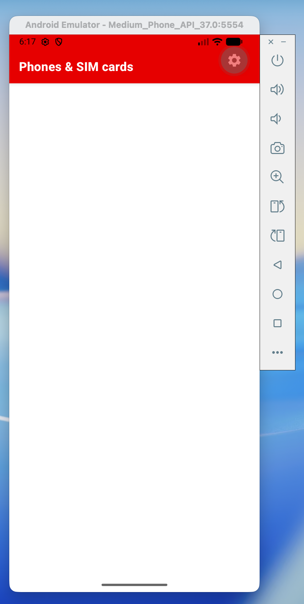
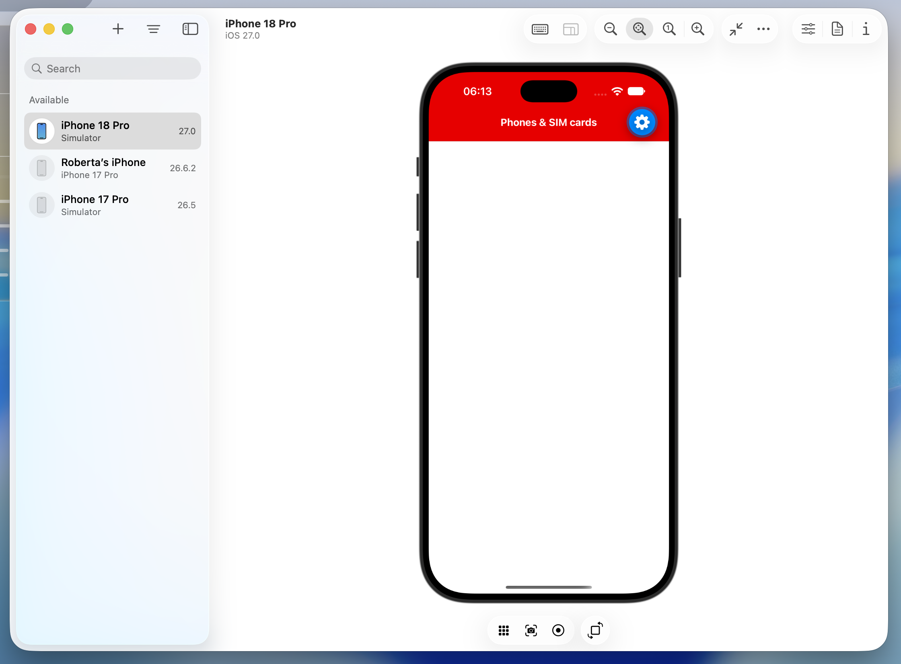

# Exercise 1: Installation

This is an interactive workshop. Please set up before the session. You only need to pick **one** of these options:

**Virtual device**
- Android emulator
- iOS simulator (you need a Mac)

**Real device**
- Android device
- iOS device

**Virtual development environment**
- Expo Snack: [React Native Workshop](https://snack.expo.dev/@rogoodvoda/react-native-workshop)

The demo is a React Native app run with Expo, an open-source framework built on top of React Native.

If you are stuck on an option
- Go for the emulator/simulator if you want something closest to our day to day developemnt.
- Go for Expo snack if you don't have time, or cannot install the tools.

## Step 1: Emulator, simulator or real device

1. Clone the workshop repo: https://github.com/VFUK-Digital/react_native_sample_app
2. Install the supporting tools: [Set up your environment](https://docs.expo.dev/get-started/set-up-your-environment/). You also need Node.js 20.19.4 or newer (https://nodejs.org) and Git (https://git-scm.com/downloads).
3. Then, depending on your option:
   - **Emulator or simulator:** install Xcode for the iOS simulator (Mac only), or Android Studio for the Android emulator. The setup link above walks you through it. Create a virtual device, and for iOS use iOS 16.4 or newer.
   - **Real device:** install **Expo Go** on your device (App Store or Play Store) and create an Expo account at https://expo.dev/signup. You can use any email, as this is a demo site.

## Step 2: Expo Snack

You can work directly in the Snack instead. No setup is required, and you don't need an account. This is enough for the workshop. If you use it, skip Steps 3 and 4.

## Step 3: Install the packages

From the project folder:

```bash
npm install
```

Stay on the default branch unless you are told to switch.

## Step 4: Start the app

Start the app and leave it running while you work:

- **Android emulator:** `npm run android`
- **iOS simulator:** `npm run ios`
- **Real device:**
  1. Sign in to your Expo account in the terminal:
     ```bash
     npx expo login
     ```
  2. Put your device on the same Wi-Fi network as your computer.
  3. Start the app:
     ```bash
     npm run start
     ```
  4. Scan the QR code from the terminal. On an iPhone use the Camera app. On Android open Expo Go and tap **Scan QR code**.

However you run it, you should see a blank red header and a white screen, like this:

<p align="center">
  
  
</p>

Expo Go is installed into an emulator or simulator for you. On a real device, sign in to the same Expo account in Expo Go, and update Expo Go if it reports a version mismatch.

You should see a header, "Phones & SIM cards", above an empty screen. Fast Refresh applies each change on save.
