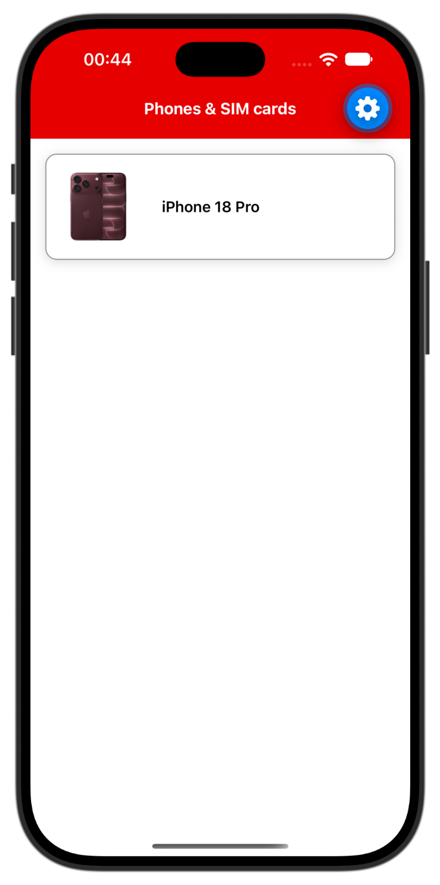
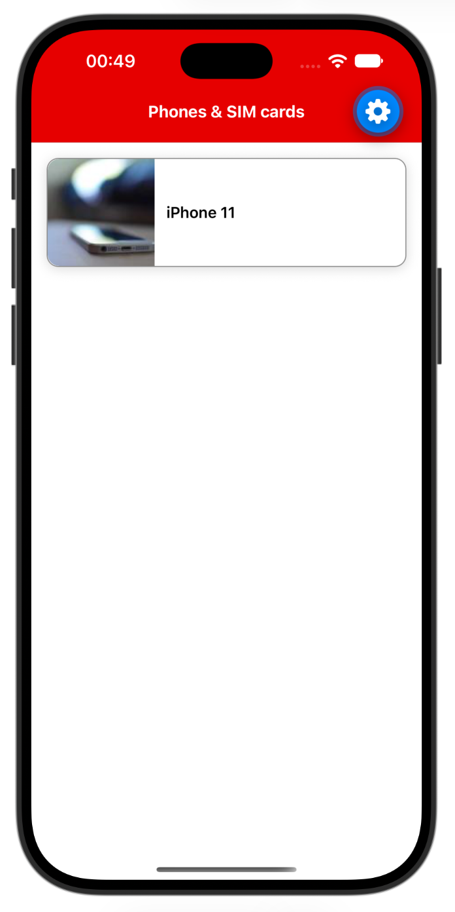

# Exercise 2: Build a product card

You are going to make a single product card: the image and the product name on one row, inside a card.

<p align="center"></p>

---

## Step 1: Paste the snippet

Paste this into `src/screens/ProductListScreen.tsx`. The card appears.

**`src/screens/ProductListScreen.tsx`**

```tsx
import { Image, StyleSheet, Text, View } from 'react-native';
import { colors } from '../theme/colors';

export default function ProductListScreen() {
  return (
    <View style={styles.container}>
      <View>
        <Image
          source={{ uri: 'https://picsum.photos/id/160/120/120' }}
          style={styles.image}
        />
        <Text style={styles.name}>iPhone 11</Text>
      </View>
    </View>
  );
}

const styles = StyleSheet.create({
  container: {
    flex: 1,
    backgroundColor: colors.background,
  },
  card: {
    flexDirection: 'row',
    alignItems: 'center',
    margin: 16,
    borderRadius: 12,
    borderWidth: 1,
    borderColor: colors.borderStrong,
    backgroundColor: colors.background,
    shadowColor: '#000',
    shadowOffset: { width: 0, height: 2 },
    shadowOpacity: 0.15,
    shadowRadius: 6,
    elevation: 4,
  },
  image: {
    width: 110,
    height: 110,
    borderTopLeftRadius: 12,
    borderBottomLeftRadius: 12,
  },
  name: {
    flex: 1,
    padding: 12,
    fontSize: 16,
    fontWeight: '600',
  },
});
```

---

## Step 2: Make the changes

Now make it yours. Save after each change and the app refreshes.

1. Add the **card** style to the View around the image and the name: `style={styles.card}`.
2. Change the text to **iPhone 18 Pro**.
3. **Change the image from remote to local.** Use the file `assets/images/Apple_iPhone_18_Pro.png` instead of the web address.

After task 1 the card looks like this, still with the original text and the remote image. After all three tasks it matches the screenshot at the top.

<p align="center"></p>

<details>
<summary>Hint for the image</summary>

A remote image uses `source={{ uri: '...' }}`. A local image uses `require` with a path to the file. The path is relative to the file you are editing, so from `src/screens` go up two folders:

```tsx
source={require('../../assets/images/Apple_iPhone_18_Pro.png')}
```

</details>

If you finish early, feel free to play around with the code.

Optional: `npm test` verifies your work. Tests for later exercises fail until you reach them.

References: [Image](https://reactnative.dev/docs/image), [Images](https://reactnative.dev/docs/images), [View](https://reactnative.dev/docs/view), [Text](https://reactnative.dev/docs/text), [StyleSheet](https://reactnative.dev/docs/stylesheet), [Flexbox](https://reactnative.dev/docs/flexbox).

## Final Solution

```tsx
import { Image, StyleSheet, Text, View } from 'react-native';
import { colors } from '../theme/colors';

export default function ProductListScreen() {
  return (
    <View style={styles.container}>
      <View style={styles.card}>
        <Image
          source={require('../../assets/images/Apple_iPhone_18_Pro.png')}
          style={styles.image}
        />
        <Text style={styles.name}>iPhone 18 Pro</Text>
      </View>
    </View>
  );
}

const styles = StyleSheet.create({
  container: {
    flex: 1,
    backgroundColor: colors.background,
  },
  card: {
    flexDirection: 'row',
    alignItems: 'center',
    margin: 16,
    borderRadius: 12,
    borderWidth: 1,
    borderColor: colors.borderStrong,
    backgroundColor: colors.background,
    shadowColor: '#000',
    shadowOffset: { width: 0, height: 2 },
    shadowOpacity: 0.15,
    shadowRadius: 6,
    elevation: 4,
  },
  image: {
    width: 110,
    height: 110,
    borderTopLeftRadius: 12,
    borderBottomLeftRadius: 12,
  },
  name: {
    flex: 1,
    padding: 12,
    fontSize: 16,
    fontWeight: '600',
  },
});
```
