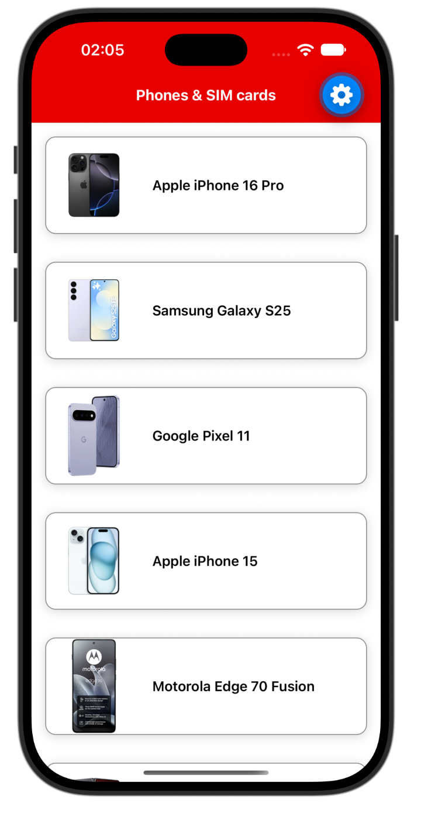
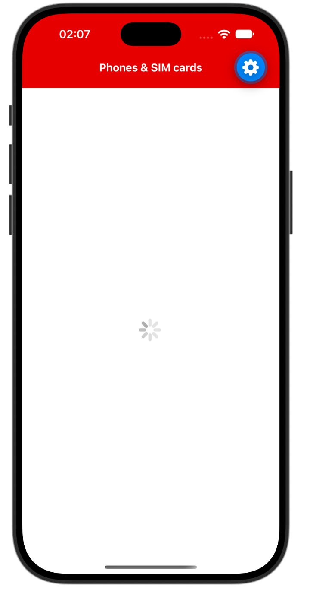
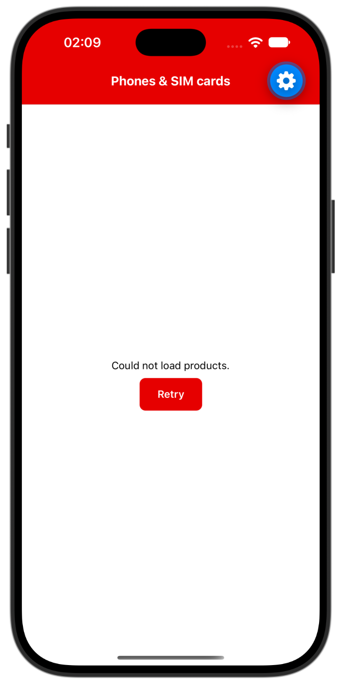
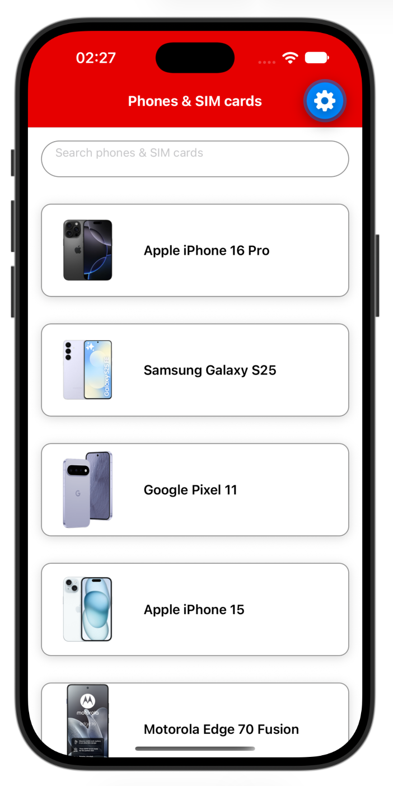
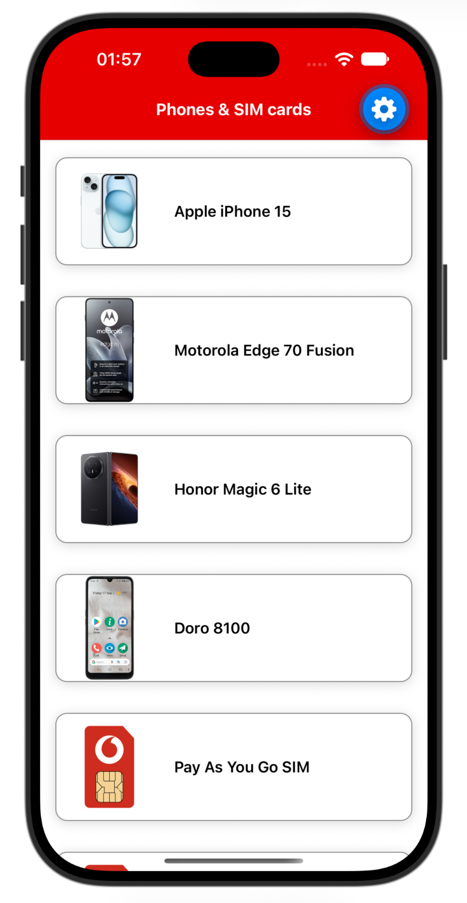

# Exercise 3: Load the products

Load the products and show them in a list, like the screenshots: the list, a spinner while it loads, and an error message with a **Retry** button if loading fails.

<p align="center">
  
  
  
</p>

---

## Step 1: Paste the snippet

Paste this into `src/screens/ProductListScreen.tsx`. A spinner shows for 2 seconds, then the products appear. `getProducts()` in `src/services/productsService.ts` is provided, and returns the products after a 2 second delay to simulate a slow network call.

<p align="center"></p>

Try to scroll the list. It does not scroll: `map` just renders every product, one after another, in a plain `View`.

**`src/screens/ProductListScreen.tsx`**

```tsx
import { useEffect, useState } from 'react';
import { ActivityIndicator, Image, Pressable, StyleSheet, Text, View } from 'react-native';
import { getProducts } from '../services/productsService';
import { colors } from '../theme/colors';
import { Product } from '../types/product';

export default function ProductListScreen() {
  const [products, setProducts] = useState<Product[]>([]);
  const [loading, setLoading] = useState<boolean>(true);
  const [error, setError] = useState<boolean>(false);

  function loadProducts() {
    setLoading(true);
    setError(false);
    getProducts()
      .then(setProducts)
      .catch(() => setError(true))
      .finally(() => setLoading(false));
  }

  useEffect(() => {
    loadProducts();
  }, []);

  if (loading) {
    return (
      <View style={styles.container}>
        <ActivityIndicator size="small" style={styles.loader} />
      </View>
    );
  }

  if (error) {
    return (
      <View style={styles.message}>
        <Text>Could not load products.</Text>
        <Pressable style={styles.retryButton} onPress={loadProducts}>
          <Text style={styles.retryText}>Retry</Text>
        </Pressable>
      </View>
    );
  }

  return (
    <View style={styles.container}>
      {products.map((item) => (
        <View key={item.id} style={styles.card}>
          <Image
            source={item.image}
            style={styles.image}
          />
          <Text style={styles.name}>{item.name}</Text>
        </View>
      ))}
    </View>
  );
}

const styles = StyleSheet.create({
  container: {
    flex: 1,
    backgroundColor: colors.background,
  },
  card: {
    flexDirection: 'row',
    alignItems: 'center',
    margin: 16,
    borderRadius: 12,
    borderWidth: 1,
    borderColor: colors.borderStrong,
    backgroundColor: colors.background,
    shadowColor: '#000',
    shadowOffset: { width: 0, height: 2 },
    shadowOpacity: 0.15,
    shadowRadius: 6,
    elevation: 4,
  },
  image: {
    width: 110,
    height: 110,
    borderTopLeftRadius: 12,
    borderBottomLeftRadius: 12,
  },
  name: { flex: 1, padding: 12, fontSize: 16, fontWeight: '600' },
  loader: { flex: 1 },
  message: { flex: 1, alignItems: 'center', justifyContent: 'center', gap: 8, padding: 16 },
  retryButton: {
    backgroundColor: colors.primary,
    minHeight: 44,
    justifyContent: 'center',
    paddingHorizontal: 24,
    paddingVertical: 10,
    borderRadius: 8,
  },
  retryText: { color: colors.badgeText, fontWeight: '600' },
});
```

---

## Step 2: Make the changes

Save after each change and the app refreshes.

1. **Convert the `map` to a `FlatList`.** A `map` renders every product at once and the screen doesn't scroll. `FlatList` makes the list scrollable, and only renders what is on screen. Once you have converted it, the list should scroll.
2. **Change the size of the activity indicator** from small to **large**.
3. **Mock an error, then recover.** In `src/services/productsService.ts`, change `getProducts` so it fails. The error message and the **Retry** button appear. Click **Retry**, then change `getProducts` back and click **Retry** again to see the products.

With the `FlatList` in place, the list scrolls:

<p align="center"></p>

<details>
<summary>Hint for the FlatList</summary>

`FlatList` takes `data`, a `keyExtractor` and a `renderItem`. What you returned inside the `map` goes inside `renderItem`, and the `key` becomes the `keyExtractor`. Import `FlatList` from `react-native`.

```tsx
<FlatList
  data={products}
  keyExtractor={(item) => item.id}
  renderItem={({ item }) => (
    // the card goes here
  )}
/>
```

</details>

<details>
<summary>Hint for the error</summary>

In `src/services/productsService.ts`, replace the body of `getProducts` with a promise that rejects:

```ts
return new Promise((_resolve, reject) => {
  setTimeout(() => reject(new Error('Network down')), 2000);
});
```

To change it back, use the original body:

```ts
return new Promise((resolve) => {
  setTimeout(() => resolve(products), 2000);
});
```

If the error does not appear after you save, reload the app.

</details>

### Notes

- **`map` or `FlatList`.** Items rendered with `map` are not scrollable. They become scrollable with `FlatList`. A `ScrollView` would also make them scroll, but it is not needed here because `FlatList` does it for us. For an example of `ScrollView`, see the details page in `src/screens/ProductDetailsScreen.tsx`.
- **`require` must be static.** A local image is loaded with `require('../../assets/images/Some_Phone.png')`, and the path has to be written out in full. You cannot build it from data, for example `require('../../assets/images/' + item.fileName)`, because the bundler works out which images to include before the app runs. The workaround is already in place. `src/data/products.ts` has one `require` for each image, and gives every product a ready-to-use `image` from the `localImage` path in `products.json`. That is why the card can use `source={item.image}`.

If you finish early, feel free to play around with the code.

Optional: `npm test` should now show the tests passing.

References: [FlatList](https://reactnative.dev/docs/flatlist), [ActivityIndicator](https://reactnative.dev/docs/activityindicator), [Pressable](https://reactnative.dev/docs/pressable), [ScrollView](https://reactnative.dev/docs/scrollview), [Images](https://reactnative.dev/docs/images), [useEffect](https://react.dev/reference/react/useEffect).

## Final Solution

```tsx
import { useEffect, useState } from 'react';
import { ActivityIndicator, FlatList, Image, Pressable, StyleSheet, Text, View } from 'react-native';
import { getProducts } from '../services/productsService';
import { colors } from '../theme/colors';
import { Product } from '../types/product';

export default function ProductListScreen() {
  const [products, setProducts] = useState<Product[]>([]);
  const [loading, setLoading] = useState<boolean>(true);
  const [error, setError] = useState<boolean>(false);

  function loadProducts() {
    setLoading(true);
    setError(false);
    getProducts()
      .then(setProducts)
      .catch(() => setError(true))
      .finally(() => setLoading(false));
  }

  useEffect(() => {
    loadProducts();
  }, []);

  if (loading) {
    return (
      <View style={styles.container}>
        <ActivityIndicator size="large" style={styles.loader} />
      </View>
    );
  }

  if (error) {
    return (
      <View style={styles.message}>
        <Text>Could not load products.</Text>
        <Pressable style={styles.retryButton} onPress={loadProducts}>
          <Text style={styles.retryText}>Retry</Text>
        </Pressable>
      </View>
    );
  }

  return (
    <View style={styles.container}>
      <FlatList
        data={products}
        keyExtractor={(item) => item.id}
        renderItem={({ item }) => (
          <View style={styles.card}>
            <Image
              source={item.image}
              style={styles.image}
            />
            <Text style={styles.name}>{item.name}</Text>
          </View>
        )}
      />
    </View>
  );
}

const styles = StyleSheet.create({
  container: {
    flex: 1,
    backgroundColor: colors.background,
  },
  card: {
    flexDirection: 'row',
    alignItems: 'center',
    margin: 16,
    borderRadius: 12,
    borderWidth: 1,
    borderColor: colors.borderStrong,
    backgroundColor: colors.background,
    shadowColor: '#000',
    shadowOffset: { width: 0, height: 2 },
    shadowOpacity: 0.15,
    shadowRadius: 6,
    elevation: 4,
  },
  image: {
    width: 110,
    height: 110,
    borderTopLeftRadius: 12,
    borderBottomLeftRadius: 12,
  },
  name: { flex: 1, padding: 12, fontSize: 16, fontWeight: '600' },
  loader: { flex: 1 },
  message: { flex: 1, alignItems: 'center', justifyContent: 'center', gap: 8, padding: 16 },
  retryButton: {
    backgroundColor: colors.primary,
    minHeight: 44,
    justifyContent: 'center',
    paddingHorizontal: 24,
    paddingVertical: 10,
    borderRadius: 8,
  },
  retryText: { color: colors.badgeText, fontWeight: '600' },
});
```
