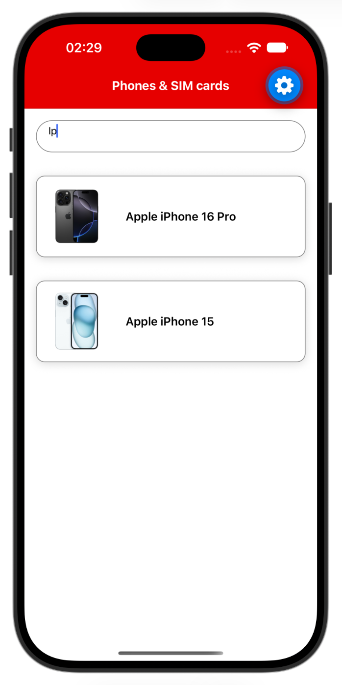
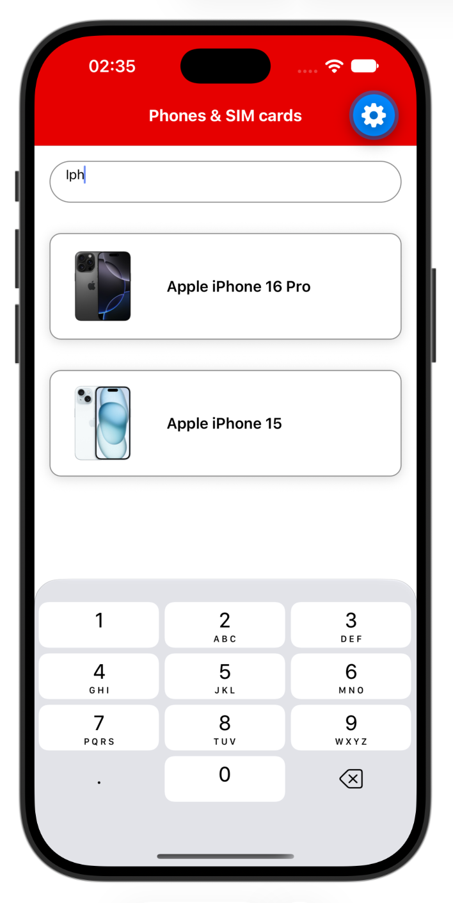

# Exercise 4: Interactivity and accessibility

Add search to the list, then make the list usable with a screen reader. First you will see how a few `TextInput` props change the keyboard and the field. Then you will add the accessibility labels and roles that VoiceOver (iOS) and TalkBack (Android) need.

<p align="center"></p>

---

## Step 1: Paste the snippet

Paste this into `src/screens/ProductListScreen.tsx`. The search box is connected to state and the list filters from it, but the box has three extra props: `editable={false}`, `keyboardType="numeric"` and `multiline` with `numberOfLines={5}`. The snippet also has a readable placeholder colour and a message for an empty search. It has no accessibility labels or roles yet.

**`src/screens/ProductListScreen.tsx`**

```tsx
import { useEffect, useState } from 'react';
import {
  ActivityIndicator,
  FlatList,
  Image,
  Pressable,
  StyleSheet,
  Text,
  TextInput,
  View,
} from 'react-native';
import { getProducts } from '../services/productsService';
import { colors } from '../theme/colors';
import { Product } from '../types/product';

export default function ProductListScreen() {
  const [query, setQuery] = useState<string>('');
  const [products, setProducts] = useState<Product[]>([]);
  const [loading, setLoading] = useState<boolean>(true);
  const [error, setError] = useState<boolean>(false);

  function loadProducts() {
    setLoading(true);
    setError(false);
    getProducts()
      .then(setProducts)
      .catch(() => setError(true))
      .finally(() => setLoading(false));
  }

  useEffect(() => {
    loadProducts();
  }, []);

  if (loading) {
    return (
      <View style={styles.container}>
        <ActivityIndicator size="large" style={styles.loader} />
      </View>
    );
  }

  if (error) {
    return (
      <View style={styles.message}>
        <Text>Could not load products.</Text>
        <Pressable style={styles.retryButton} onPress={loadProducts}>
          <Text style={styles.retryText}>Retry</Text>
        </Pressable>
      </View>
    );
  }

  const filteredProducts = products.filter((product) =>
    product.name.toLowerCase().includes(query.trim().toLowerCase())
  );

  return (
    <View style={styles.container}>
      <TextInput
        value={query}
        onChangeText={setQuery}
        placeholder="Search phones & SIM cards"
        placeholderTextColor={colors.textSecondary}
        editable={false}
        keyboardType="numeric"
        multiline
        numberOfLines={5}
        style={styles.input}
      />
      <FlatList
        data={filteredProducts}
        keyExtractor={(item) => item.id}
        ListEmptyComponent={<Text style={styles.empty}>No products match your search.</Text>}
        renderItem={({ item }) => (
          <View style={styles.card}>
            <Image
              source={item.image}
              style={styles.image}
            />
            <Text style={styles.name}>{item.name}</Text>
          </View>
        )}
      />
    </View>
  );
}

const styles = StyleSheet.create({
  container: {
    flex: 1,
    backgroundColor: colors.background,
  },
  input: {
    minHeight: 44,
    margin: 16,
    borderWidth: 1,
    borderColor: colors.borderStrong,
    borderRadius: 22,
    paddingHorizontal: 16,
  },
  card: {
    flexDirection: 'row',
    alignItems: 'center',
    margin: 16,
    borderRadius: 12,
    borderWidth: 1,
    borderColor: colors.borderStrong,
    backgroundColor: colors.background,
    shadowColor: '#000',
    shadowOffset: { width: 0, height: 2 },
    shadowOpacity: 0.15,
    shadowRadius: 6,
    elevation: 4,
  },
  image: {
    width: 110,
    height: 110,
    borderTopLeftRadius: 12,
    borderBottomLeftRadius: 12,
  },
  name: { flex: 1, padding: 12, fontSize: 16, fontWeight: '600' },
  empty: { padding: 16, fontSize: 16, color: colors.textSecondary },
  loader: { flex: 1 },
  message: { flex: 1, alignItems: 'center', justifyContent: 'center', gap: 8, padding: 16 },
  retryButton: {
    backgroundColor: colors.primary,
    minHeight: 44,
    justifyContent: 'center',
    paddingHorizontal: 24,
    paddingVertical: 10,
    borderRadius: 8,
  },
  retryText: { color: colors.badgeText, fontWeight: '600' },
});
```

---

## Step 2: Remove the props and observe

**Before you change anything,** tap the search box and watch the keyboard. Does one appear? Can you type?

<p align="center"></p>

Then remove the three props one at a time. After each change, tap the search box again and see what is different.

1. **Disabled.** Remove `editable={false}`.
2. **Keyboard type.** Change `keyboardType` from `"numeric"` to `"default"`, or remove it.
3. **Multiline.** Remove `multiline` and `numberOfLines={5}`.

When you are done, type "pixel" and the list narrows.

Tip for the iOS simulator: if no keyboard appears, the Mac keyboard is being used instead. Choose I/O > Keyboard > Toggle Software Keyboard to show the on-screen one.

### Notes

| Prop | What it does |
| --- | --- |
| `editable={false}` | The field is disabled. It can't be typed in, so no keyboard appears. |
| `keyboardType` | Chooses which on-screen keyboard appears. `"default"` is the normal text keyboard, which suits a search box. Other values include `"numeric"`, `"email-address"`, `"phone-pad"` and `"url"`. Match the keyboard to the data you expect. |
| `multiline` and `numberOfLines` | The field takes several lines, and the Return key starts a new line instead of finishing. `numberOfLines={5}` asks for five lines of room. Whether it has an effect can depend on the platform. |

- `onChangeText` passes the new string, not an event object.
- `Pressable` is the generic touch target. You already used it for the Retry button: there is no `onClick`, and `onPress` fires on a tap. React Native's built-in `Button` renders as plain text on iOS and can't be styled much, which is why the Retry button is a `Pressable` with a `Text` inside.

---

## Step 3: Add the labels and roles

1. **Add `accessibilityLabel`** to the things a screen reader can't read from the screen:
   - the search box: "Search phones"
   - the spinner: "Loading products"
   - the Retry button: "Retry loading products"
   - the product image: the product name. An image also needs `accessible`, otherwise iOS skips it.
2. **Add `accessibilityRole`**, which says what an element is:
   - the Retry button: `"button"`
   - the error message and the empty-search message: `"alert"`, which marks them as important.

### How to test

Turn the screen reader on, then move through the screen one element at a time. Swipe right to go to the next element and double-tap to activate it. Listen for each label, and for the role after it, such as "button".

| Run method | Can you test it? | How |
| --- | --- | --- |
| iPhone (Expo Go) | Yes | Use VoiceOver. Settings > Accessibility > VoiceOver. Turn it off in the same place. |
| Android phone (Expo Go) | Yes | Use TalkBack. Settings > Accessibility > TalkBack > Use TalkBack. Turn it off in the same place. |
| Android emulator | Maybe | Use TalkBack, in the same place. It is only there if the emulator image includes Google Play, so some images won't have it. |
| iOS simulator | Not with VoiceOver | VoiceOver does not run on the simulator. Use Xcode's Accessibility Inspector instead. Xcode > Open Developer Tool > Accessibility Inspector, choose the running simulator as the target, then click an element to see its label and role. |
| Web (`npm run web`) | Partly | There is no screen reader built in, but the browser shows what one would read. Right-click an element, choose Inspect, and open the Accessibility tab (Chrome). On a Mac you can also turn on VoiceOver with Cmd+F5. |
| Expo Snack | No | A screen reader can't run on the Snack's device previews. Use the web preview with the browser tools above. |

Whatever you run on, you can also check the code itself. If you use Visual Studio Code, install the [axe Accessibility Linter](https://marketplace.visualstudio.com/items?itemName=deque-systems.vscode-axe-linter) extension. It flags accessibility problems as you type, for example an image with no label. Look for squiggly underlines, or open the Problems panel (View > Problems). The repo's `axe-linter.yml` turns on the React Native rules. If nothing is flagged, reload the window (Command Palette > Developer: Reload Window).

### Other accessibility techniques

The finished app uses a few more techniques. You do not need to add them now.

- **Roles.** `accessibilityRole` says what an element is: `"button"` for the cards and the Retry button, `"header"` for headings, and `"alert"` for error messages.
- **Labels that describe the action.** A card is labelled "View details for Samsung Galaxy S25", not just the name.
- **Hiding things.** `importantForAccessibility="no"` hides an element from screen readers on Android, for example text that would otherwise be read twice. The iOS equivalent is `accessibilityElementsHidden`.
- **Grouping.** A `Pressable` is read as one element, so anything inside it cannot be reached separately. Keep that in mind when you put a button inside a card.
- **Text that grows.** `minHeight` and `minWidth` instead of fixed `height` and `width` stop large text sizes being clipped. The search box, the Retry button and the heart use them.
- **Contrast.** The theme colours meet the WCAG AA contrast ratios: 4.5:1 for text and 3:1 for borders and icons.

These come with the favourites in [Exercise 6](EXERCISE-6.md):

- **`hitSlop`** makes a small button easier to hit.
- **`accessibilityState`** tells the screen reader about a state such as selected, checked, disabled or busy.
- **`accessibilityActions`** adds a custom action to the card, so a screen reader user can favourite a product without reaching the heart. It is already in the Exercise 6 snippet.

## Final Solution

```tsx
import { useEffect, useState } from 'react';
import {
  ActivityIndicator,
  FlatList,
  Image,
  Pressable,
  StyleSheet,
  Text,
  TextInput,
  View,
} from 'react-native';
import { getProducts } from '../services/productsService';
import { colors } from '../theme/colors';
import { Product } from '../types/product';

export default function ProductListScreen() {
  const [query, setQuery] = useState<string>('');
  const [products, setProducts] = useState<Product[]>([]);
  const [loading, setLoading] = useState<boolean>(true);
  const [error, setError] = useState<boolean>(false);

  function loadProducts() {
    setLoading(true);
    setError(false);
    getProducts()
      .then(setProducts)
      .catch(() => setError(true))
      .finally(() => setLoading(false));
  }

  useEffect(() => {
    loadProducts();
  }, []);

  if (loading) {
    return (
      <View style={styles.container}>
        <ActivityIndicator
          size="large"
          style={styles.loader}
          accessibilityLabel="Loading products"
        />
      </View>
    );
  }

  if (error) {
    return (
      <View style={styles.message}>
        <Text accessibilityRole="alert">Could not load products.</Text>
        <Pressable
          style={styles.retryButton}
          onPress={loadProducts}
          accessibilityRole="button"
          accessibilityLabel="Retry loading products"
        >
          <Text style={styles.retryText}>Retry</Text>
        </Pressable>
      </View>
    );
  }

  const filteredProducts = products.filter((product) =>
    product.name.toLowerCase().includes(query.trim().toLowerCase())
  );

  return (
    <View style={styles.container}>
      <TextInput
        value={query}
        onChangeText={setQuery}
        placeholder="Search phones & SIM cards"
        placeholderTextColor={colors.textSecondary}
        keyboardType="default"
        accessibilityLabel="Search phones"
        style={styles.input}
      />
      <FlatList
        data={filteredProducts}
        keyExtractor={(item) => item.id}
        ListEmptyComponent={<Text style={styles.empty} accessibilityRole="alert">No products match your search.</Text>}
        renderItem={({ item }) => (
          <View style={styles.card}>
            <Image
              source={item.image}
              style={styles.image}
              accessible
              accessibilityLabel={item.name}
            />
            <Text style={styles.name}>{item.name}</Text>
          </View>
        )}
      />
    </View>
  );
}

const styles = StyleSheet.create({
  container: {
    flex: 1,
    backgroundColor: colors.background,
  },
  input: {
    minHeight: 44,
    margin: 16,
    borderWidth: 1,
    borderColor: colors.borderStrong,
    borderRadius: 22,
    paddingHorizontal: 16,
  },
  card: {
    flexDirection: 'row',
    alignItems: 'center',
    margin: 16,
    borderRadius: 12,
    borderWidth: 1,
    borderColor: colors.borderStrong,
    backgroundColor: colors.background,
    shadowColor: '#000',
    shadowOffset: { width: 0, height: 2 },
    shadowOpacity: 0.15,
    shadowRadius: 6,
    elevation: 4,
  },
  image: {
    width: 110,
    height: 110,
    borderTopLeftRadius: 12,
    borderBottomLeftRadius: 12,
  },
  name: { flex: 1, padding: 12, fontSize: 16, fontWeight: '600' },
  empty: { padding: 16, fontSize: 16, color: colors.textSecondary },
  loader: { flex: 1 },
  message: { flex: 1, alignItems: 'center', justifyContent: 'center', gap: 8, padding: 16 },
  retryButton: {
    backgroundColor: colors.primary,
    minHeight: 44,
    justifyContent: 'center',
    paddingHorizontal: 24,
    paddingVertical: 10,
    borderRadius: 8,
  },
  retryText: { color: colors.badgeText, fontWeight: '600' },
});
```
