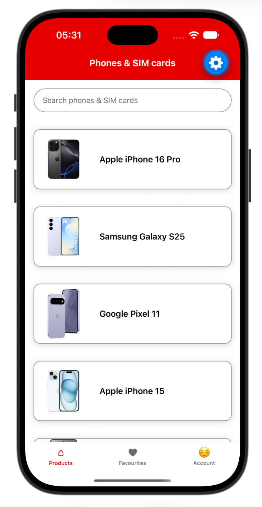
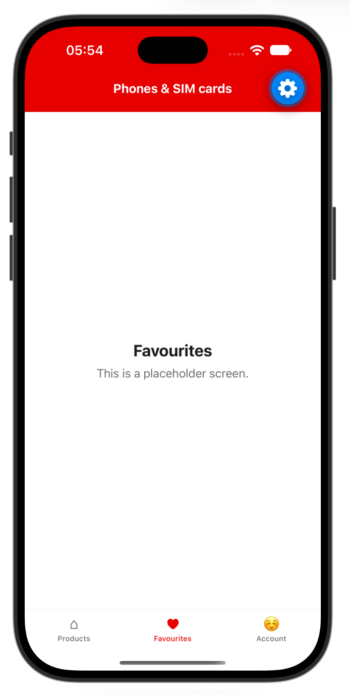
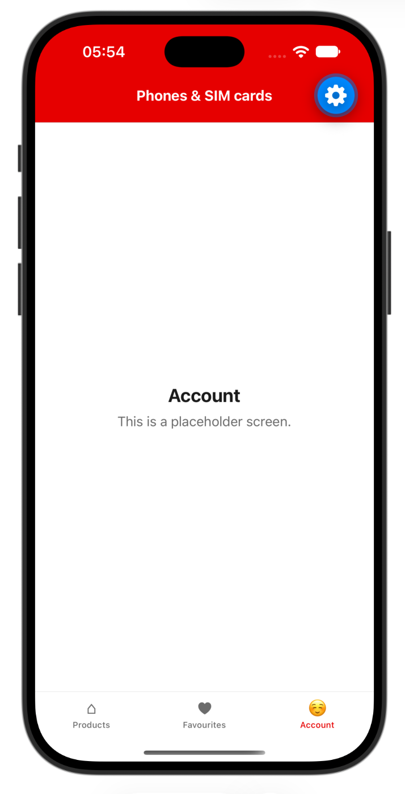
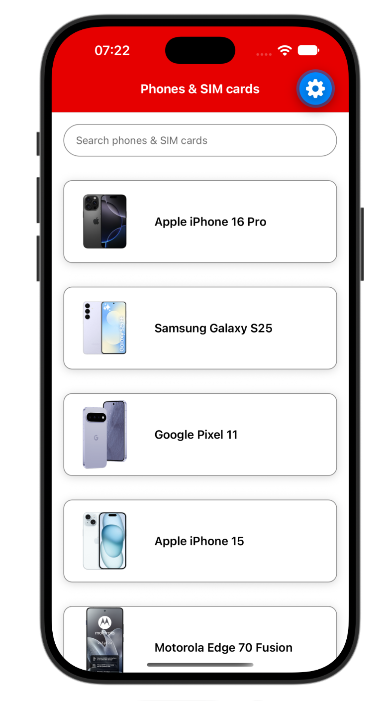
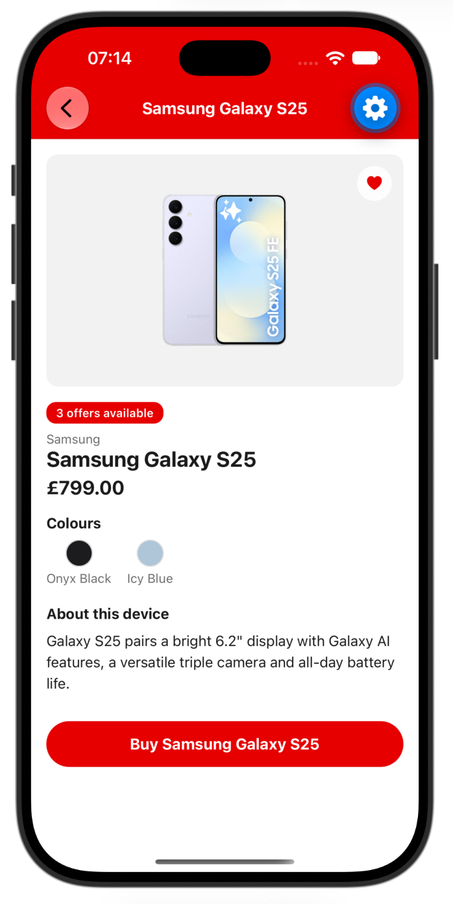

# Exercise 5: Navigation

Navigate from the list to a product's details, then add a tab bar. The tab bar is premade in `src/components`, so you only change the list screen and `App.tsx`.

<p align="center"></p>

---

## Step 1: Paste the snippets

Paste this into `src/screens/ProductListScreen.tsx`. Tapping a card does nothing yet.

**`src/screens/ProductListScreen.tsx`**

```tsx
import { useEffect, useState } from 'react';
import {
  ActivityIndicator,
  FlatList,
  Image,
  Pressable,
  StyleSheet,
  Text,
  TextInput,
  View,
} from 'react-native';
import { getProducts } from '../services/productsService';
import type { ProductListScreenProps } from '../types/navigation';
import { colors } from '../theme/colors';
import { Product } from '../types/product';

export default function ProductListScreen({ navigation }: Readonly<ProductListScreenProps>) {
  const [query, setQuery] = useState<string>('');
  const [products, setProducts] = useState<Product[]>([]);
  const [loading, setLoading] = useState<boolean>(true);
  const [error, setError] = useState<boolean>(false);

  function loadProducts() {
    setLoading(true);
    setError(false);
    getProducts()
      .then(setProducts)
      .catch(() => setError(true))
      .finally(() => setLoading(false));
  }

  useEffect(() => {
    loadProducts();
  }, []);

  if (loading) {
    return (
      <View style={styles.container}>
        <ActivityIndicator
          size="large"
          style={styles.loader}
          accessibilityLabel="Loading products"
        />
      </View>
    );
  }

  if (error) {
    return (
      <View style={styles.message}>
        <Text accessibilityRole="alert">Could not load products.</Text>
        <Pressable
          style={styles.retryButton}
          onPress={loadProducts}
          accessibilityRole="button"
          accessibilityLabel="Retry loading products"
        >
          <Text style={styles.retryText}>Retry</Text>
        </Pressable>
      </View>
    );
  }

  const filteredProducts = products.filter((product) =>
    product.name.toLowerCase().includes(query.trim().toLowerCase())
  );

  return (
    <View style={styles.container}>
      <TextInput
        value={query}
        onChangeText={setQuery}
        placeholder="Search phones & SIM cards"
        placeholderTextColor={colors.textSecondary}
        keyboardType="default"
        accessibilityLabel="Search phones"
        style={styles.input}
      />
      <FlatList
        data={filteredProducts}
        keyExtractor={(item) => item.id}
        ListEmptyComponent={<Text style={styles.empty} accessibilityRole="alert">No products match your search.</Text>}
        renderItem={({ item }) => (
          <Pressable style={styles.card}>
            <Image
              source={item.image}
              style={styles.image}
            />
            <Text style={styles.name}>{item.name}</Text>
          </Pressable>
        )}
      />
    </View>
  );
}

const styles = StyleSheet.create({
  container: {
    flex: 1,
    backgroundColor: colors.background,
  },
  input: {
    minHeight: 44,
    margin: 16,
    borderWidth: 1,
    borderColor: colors.borderStrong,
    borderRadius: 22,
    paddingHorizontal: 16,
  },
  card: {
    flexDirection: 'row',
    alignItems: 'center',
    margin: 16,
    borderRadius: 12,
    borderWidth: 1,
    borderColor: colors.borderStrong,
    backgroundColor: colors.background,
    shadowColor: '#000',
    shadowOffset: { width: 0, height: 2 },
    shadowOpacity: 0.15,
    shadowRadius: 6,
    elevation: 4,
  },
  image: {
    width: 110,
    height: 110,
    borderTopLeftRadius: 12,
    borderBottomLeftRadius: 12,
  },
  name: { flex: 1, padding: 12, fontSize: 16, fontWeight: '600' },
  empty: { padding: 16, fontSize: 16, color: colors.textSecondary },
  loader: { flex: 1 },
  message: { flex: 1, alignItems: 'center', justifyContent: 'center', gap: 8, padding: 16 },
  retryButton: {
    backgroundColor: colors.primary,
    minHeight: 44,
    justifyContent: 'center',
    paddingHorizontal: 24,
    paddingVertical: 10,
    borderRadius: 8,
  },
  retryText: { color: colors.badgeText, fontWeight: '600' },
});
```

`src/App.tsx` is already set up like this. The details screen is already built too:

**`src/App.tsx`**

```tsx
import { NavigationContainer } from '@react-navigation/native';
import { createNativeStackNavigator } from '@react-navigation/native-stack';
import type { RootStackParamList } from './types/navigation';
import ProductDetailsScreen from './screens/ProductDetailsScreen';
import ProductListScreen from './screens/ProductListScreen';
import { colors } from './theme/colors';

const Stack = createNativeStackNavigator<RootStackParamList>();

export default function App() {
  return (
    <NavigationContainer>
      <Stack.Navigator
        initialRouteName="ProductList"
        screenOptions={{
          headerStyle: { backgroundColor: colors.primary },
          headerTintColor: colors.badgeText,
          headerTitleStyle: { fontWeight: '700' },
          contentStyle: { backgroundColor: colors.background },
        }}
      >
        <Stack.Screen
          name="ProductList"
          component={ProductListScreen}
          options={{ title: 'Phones & SIM cards' }}
        />
        <Stack.Screen
          name="ProductDetails"
          component={ProductDetailsScreen}
          options={{ title: 'Product details' }}
        />
      </Stack.Navigator>
    </NavigationContainer>
  );
}
```

These premade components are in `src/components`. You don't need to change them:

- `Tabs.tsx`: a bottom tab bar with Products, Favourites and Account.
- `PlaceholderScreen.tsx`: a dummy screen for the tabs that have no real content yet.

<p align="center">
  
  
</p>

They use `@react-navigation/bottom-tabs`, which is already in `package.json`.

---

## Step 2: Make the changes

1. **Trigger navigation to the details page.** In `ProductListScreen.tsx`, give the card an `onPress` that calls `navigation.navigate('ProductDetails', { id: item.id })`. Tap a card to open its details, then go back.

<p align="center">
  
  
</p>

2. **Add a tab bar.** In `App.tsx`, import `Tabs` from `./components/Tabs` and use it as the `component` of the `ProductList` screen instead of `ProductListScreen`. The Products tab shows the list. Favourites and Account are placeholders.

<details>
<summary>Hint for the navigation</summary>

Every screen in a navigator gets a `navigation` prop. `navigate('ProductDetails', { id: item.id })` goes to the screen with that name and passes the product's `id`. The details screen reads it from `route.params.id`. The names and params are typed in `src/types/navigation.ts`.

</details>

### Notes

- **Nested navigators.** The list is now inside the tabs, inside the stack. `navigate('ProductDetails')` still works, because React Navigation looks up through the parent navigators for one that has a screen with that name.
- **The card.** A `Pressable` is read as one element by a screen reader, so the image no longer needs its own `accessible` or `accessibilityLabel`. The product name is read from the card.
- **Docs:** [React Navigation](https://reactnavigation.org/docs/getting-started), [Bottom tabs](https://reactnavigation.org/docs/bottom-tab-navigator), [Nesting navigators](https://reactnavigation.org/docs/nesting-navigators).

**Optional:** `npm test` should now show the tests passing.

## Final Solution

**`src/screens/ProductListScreen.tsx`**

```tsx
import { useEffect, useState } from 'react';
import {
  ActivityIndicator,
  FlatList,
  Image,
  Pressable,
  StyleSheet,
  Text,
  TextInput,
  View,
} from 'react-native';
import { getProducts } from '../services/productsService';
import type { ProductListScreenProps } from '../types/navigation';
import { colors } from '../theme/colors';
import { Product } from '../types/product';

export default function ProductListScreen({ navigation }: Readonly<ProductListScreenProps>) {
  const [query, setQuery] = useState<string>('');
  const [products, setProducts] = useState<Product[]>([]);
  const [loading, setLoading] = useState<boolean>(true);
  const [error, setError] = useState<boolean>(false);

  function loadProducts() {
    setLoading(true);
    setError(false);
    getProducts()
      .then(setProducts)
      .catch(() => setError(true))
      .finally(() => setLoading(false));
  }

  useEffect(() => {
    loadProducts();
  }, []);

  if (loading) {
    return (
      <View style={styles.container}>
        <ActivityIndicator
          size="large"
          style={styles.loader}
          accessibilityLabel="Loading products"
        />
      </View>
    );
  }

  if (error) {
    return (
      <View style={styles.message}>
        <Text accessibilityRole="alert">Could not load products.</Text>
        <Pressable
          style={styles.retryButton}
          onPress={loadProducts}
          accessibilityRole="button"
          accessibilityLabel="Retry loading products"
        >
          <Text style={styles.retryText}>Retry</Text>
        </Pressable>
      </View>
    );
  }

  const filteredProducts = products.filter((product) =>
    product.name.toLowerCase().includes(query.trim().toLowerCase())
  );

  return (
    <View style={styles.container}>
      <TextInput
        value={query}
        onChangeText={setQuery}
        placeholder="Search phones & SIM cards"
        placeholderTextColor={colors.textSecondary}
        keyboardType="default"
        accessibilityLabel="Search phones"
        style={styles.input}
      />
      <FlatList
        data={filteredProducts}
        keyExtractor={(item) => item.id}
        ListEmptyComponent={<Text style={styles.empty} accessibilityRole="alert">No products match your search.</Text>}
        renderItem={({ item }) => (
          <Pressable
            style={styles.card}
            onPress={() => navigation.navigate('ProductDetails', { id: item.id })}
          >
            <Image
              source={item.image}
              style={styles.image}
            />
            <Text style={styles.name}>{item.name}</Text>
          </Pressable>
        )}
      />
    </View>
  );
}

const styles = StyleSheet.create({
  container: {
    flex: 1,
    backgroundColor: colors.background,
  },
  input: {
    minHeight: 44,
    margin: 16,
    borderWidth: 1,
    borderColor: colors.borderStrong,
    borderRadius: 22,
    paddingHorizontal: 16,
  },
  card: {
    flexDirection: 'row',
    alignItems: 'center',
    margin: 16,
    borderRadius: 12,
    borderWidth: 1,
    borderColor: colors.borderStrong,
    backgroundColor: colors.background,
    shadowColor: '#000',
    shadowOffset: { width: 0, height: 2 },
    shadowOpacity: 0.15,
    shadowRadius: 6,
    elevation: 4,
  },
  image: {
    width: 110,
    height: 110,
    borderTopLeftRadius: 12,
    borderBottomLeftRadius: 12,
  },
  name: { flex: 1, padding: 12, fontSize: 16, fontWeight: '600' },
  empty: { padding: 16, fontSize: 16, color: colors.textSecondary },
  loader: { flex: 1 },
  message: { flex: 1, alignItems: 'center', justifyContent: 'center', gap: 8, padding: 16 },
  retryButton: {
    backgroundColor: colors.primary,
    minHeight: 44,
    justifyContent: 'center',
    paddingHorizontal: 24,
    paddingVertical: 10,
    borderRadius: 8,
  },
  retryText: { color: colors.badgeText, fontWeight: '600' },
});
```

**`src/App.tsx`**

```tsx
import { NavigationContainer } from '@react-navigation/native';
import { createNativeStackNavigator } from '@react-navigation/native-stack';
import type { RootStackParamList } from './types/navigation';
import Tabs from './components/Tabs';
import ProductDetailsScreen from './screens/ProductDetailsScreen';
import { colors } from './theme/colors';

const Stack = createNativeStackNavigator<RootStackParamList>();

export default function App() {
  return (
    <NavigationContainer>
      <Stack.Navigator
        initialRouteName="ProductList"
        screenOptions={{
          headerStyle: { backgroundColor: colors.primary },
          headerTintColor: colors.badgeText,
          headerTitleStyle: { fontWeight: '700' },
          contentStyle: { backgroundColor: colors.background },
        }}
      >
        <Stack.Screen
          name="ProductList"
          component={Tabs}
          options={{ title: 'Phones & SIM cards' }}
        />
        <Stack.Screen
          name="ProductDetails"
          component={ProductDetailsScreen}
          options={{ title: 'Product details' }}
        />
      </Stack.Navigator>
    </NavigationContainer>
  );
}
```
