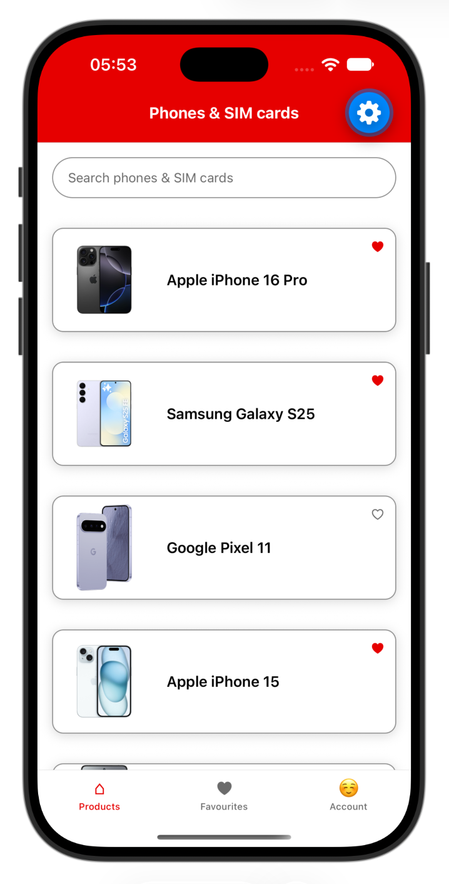

# Exercise 6: Storage

Save the favourites, so a product you favourite is still a favourite after you close and reopen the app. You will save them with `AsyncStorage`, then make the heart easier to use.

<p align="center"></p>

---

## Step 1: Paste the snippet

Paste this into `src/screens/ProductListScreen.tsx`. Each card has a heart that toggles the favourite, but nothing is saved yet, so every favourite is lost when the app reloads.

**`src/screens/ProductListScreen.tsx`**

```tsx
import { useFocusEffect } from '@react-navigation/native';
import { useCallback, useEffect, useState } from 'react';
import {
  ActivityIndicator,
  FlatList,
  Image,
  Pressable,
  StyleSheet,
  Text,
  TextInput,
  View,
} from 'react-native';
import { getFavouriteIds, getProducts, toggleFavourite } from '../services/productsService';
import type { ProductListScreenProps } from '../types/navigation';
import { colors } from '../theme/colors';
import { Product } from '../types/product';

export default function ProductListScreen({ navigation }: Readonly<ProductListScreenProps>) {
  const [query, setQuery] = useState<string>('');
  const [products, setProducts] = useState<Product[]>([]);
  const [favouriteIds, setFavouriteIds] = useState<string[]>([]);
  const [loading, setLoading] = useState<boolean>(true);
  const [error, setError] = useState<boolean>(false);

  function loadProducts() {
    setLoading(true);
    setError(false);
    getProducts()
      .then(setProducts)
      .catch(() => setError(true))
      .finally(() => setLoading(false));
  }

  useEffect(() => {
    loadProducts();
  }, []);

  useFocusEffect(
    useCallback(() => {
      getFavouriteIds()
        .then(setFavouriteIds)
        .catch(() => { /* This would normally be handled by a toast or some user notification. Out of scope. */ });
    }, [])
  );

  async function onFavouriteButtonPress(product: Product) {
    const updatedFavouriteIds = await toggleFavourite(product.id);
    setFavouriteIds(updatedFavouriteIds);
  }

  if (loading) {
    return (
      <View style={styles.container}>
        <ActivityIndicator
          size="large"
          style={styles.loader}
          accessibilityLabel="Loading products"
        />
      </View>
    );
  }

  if (error) {
    return (
      <View style={styles.message}>
        <Text accessibilityRole="alert">Could not load products.</Text>
        <Pressable
          style={styles.retryButton}
          onPress={loadProducts}
          accessibilityRole="button"
          accessibilityLabel="Retry loading products"
        >
          <Text style={styles.retryText}>Retry</Text>
        </Pressable>
      </View>
    );
  }

  const filteredProducts = products.filter((product) =>
    product.name.toLowerCase().includes(query.trim().toLowerCase())
  );

  return (
    <View style={styles.container}>
      <TextInput
        value={query}
        onChangeText={setQuery}
        placeholder="Search phones & SIM cards"
        placeholderTextColor={colors.textSecondary}
        keyboardType="default"
        accessibilityLabel="Search phones"
        style={styles.input}
      />
      <FlatList
        data={filteredProducts}
        extraData={favouriteIds}
        keyExtractor={(item) => item.id}
        ListEmptyComponent={<Text style={styles.empty} accessibilityRole="alert">No products match your search.</Text>}
        renderItem={({ item }) => {
          const isFavourite = favouriteIds.includes(item.id);
          return (
            <View style={styles.cardWrapper}>
              <Pressable
                style={styles.card}
                onPress={() => navigation.navigate('ProductDetails', { id: item.id })}
                accessibilityRole="button"
                accessibilityLabel={`View details for ${item.name}`}
              >
                <Image
                  source={item.image}
                  style={styles.image}
                />
                <Text style={styles.name}>{item.name}</Text>
              </Pressable>
              <Pressable
                style={styles.favouriteButton}
                onPress={() => onFavouriteButtonPress(item)}
                accessibilityRole="button"
                accessibilityLabel={`Favourite ${item.name}`}
              >
                <Text style={[styles.favouriteIcon, isFavourite && styles.favouriteIconActive]}>
                  {isFavourite ? '♥' : '♡'}
                </Text>
              </Pressable>
            </View>
          );
        }}
      />
    </View>
  );
}

const styles = StyleSheet.create({
  container: {
    flex: 1,
    backgroundColor: colors.background,
  },
  input: {
    minHeight: 44,
    margin: 16,
    borderWidth: 1,
    borderColor: colors.borderStrong,
    borderRadius: 22,
    paddingHorizontal: 16,
  },
  cardWrapper: {
    margin: 16,
  },
  card: {
    flexDirection: 'row',
    alignItems: 'center',
    borderRadius: 12,
    borderWidth: 1,
    borderColor: colors.borderStrong,
    backgroundColor: colors.background,
    shadowColor: '#000',
    shadowOffset: { width: 0, height: 2 },
    shadowOpacity: 0.15,
    shadowRadius: 6,
    elevation: 4,
  },
  image: {
    width: 110,
    height: 110,
    borderTopLeftRadius: 12,
    borderBottomLeftRadius: 12,
  },
  name: { flex: 1, padding: 12, paddingRight: 44, fontSize: 16, fontWeight: '600' },
  empty: { padding: 16, fontSize: 16, color: colors.textSecondary },
  favouriteButton: {
    position: 'absolute',
    top: 6,
    right: 6,
    minWidth: 28,
    minHeight: 28,
    borderRadius: 14,
    backgroundColor: 'rgba(255,255,255,0.85)',
    alignItems: 'center',
    justifyContent: 'center',
  },
  favouriteIcon: { fontSize: 16, color: colors.textSecondary },
  favouriteIconActive: { color: colors.primary },
  loader: { flex: 1 },
  message: { flex: 1, alignItems: 'center', justifyContent: 'center', gap: 8, padding: 16 },
  retryButton: {
    backgroundColor: colors.primary,
    minHeight: 44,
    justifyContent: 'center',
    paddingHorizontal: 24,
    paddingVertical: 10,
    borderRadius: 8,
  },
  retryText: { color: colors.badgeText, fontWeight: '600' },
});
```

The favourites functions are already in `src/services/productsService.ts`. `getFavouriteIds()` reads the saved ids, and `toggleFavourite(id)` adds or removes an id and saves the new list. The two storage helpers at the bottom are empty:

**`src/services/productsService.ts`**

```ts
import AsyncStorage from '@react-native-async-storage/async-storage';
import { products } from '../data/products';
import { Product } from '../types/product';

const FAVOURITES_KEY = 'favouriteProductIds';

export function getProducts(): Promise<Product[]> {
  return new Promise((resolve) => {
    setTimeout(() => resolve(products), 2000);
  });
}

export function getFavouriteIds(): Promise<string[]> {
  return loadFavouriteIds();
}

export async function toggleFavourite(productId: string): Promise<string[]> {
  const current = await loadFavouriteIds();
  const next = current.includes(productId)
    ? current.filter((id) => id !== productId)
    : [...current, productId];
  await saveFavouriteIds(next);
  return next;
}

async function loadFavouriteIds(): Promise<string[]> {
  return [];
}

async function saveFavouriteIds(ids: string[]): Promise<void> {}
```

---

## Step 2: Make the changes

1. **Add AsyncStorage to the product storage.** In `src/services/productsService.ts`:

   - Inside `loadFavouriteIds`, read the saved ids with `AsyncStorage.getItem`:

     ```ts
     async function loadFavouriteIds(): Promise<string[]> {
       const stored = await AsyncStorage.getItem(FAVOURITES_KEY);
       return stored ? JSON.parse(stored) : [];
     }
     ```

   - Inside `saveFavouriteIds`, save the ids with `AsyncStorage.setItem`:

     ```ts
     async function saveFavouriteIds(ids: string[]): Promise<void> {
       await AsyncStorage.setItem(FAVOURITES_KEY, JSON.stringify(ids));
     }
     ```

   Favourite a product, reload the app, and it should still be a favourite.
2. **Add accessibility state.** On the heart in `ProductListScreen.tsx`, add `accessibilityState={{ selected: isFavourite }}`, so a screen reader says whether the favourite is selected.
3. **Add `hitSlop`.** On the same heart, add `hitSlop={8}`, so it is easier to hit with a finger, it adds extra 8 density independent pixels beyond the heart.

### Notes

- **`AsyncStorage`** is an async key-value store, comparable to `localStorage`. It is already installed and stores strings only.
- **`accessibilityState`** tells a screen reader about a state. `selected` says whether the heart is on. The label stays the same and only the state changes. The other states are `checked`, `disabled`, `busy` and `expanded`.
- **`hitSlop`** extends the touchable area beyond the visible button by the given number of points on every side. The heart is only 28 points wide, which is easy to miss. `hitSlop` doesn't change the layout.
- **Already in the snippet.** The list loads the favourites with `useFocusEffect`, so saved favourites appear on start and after you return from the details screen. The list screen stays mounted under the details screen, so `useEffect` would not run again on return. The card and the heart are siblings inside a wrapping `View`, not nested inside each other, so a screen reader can reach both the card and the heart as separate controls.

### Check it

1. Favourite a product.
2. Close the app, then open it again.
3. It should still be a favourite.
4. Optional: run `npm test`. Every test should pass.

## Final Solution

**`src/screens/ProductListScreen.tsx`**

```tsx
import { useFocusEffect } from '@react-navigation/native';
import { useCallback, useEffect, useState } from 'react';
import {
  ActivityIndicator,
  FlatList,
  Image,
  Pressable,
  StyleSheet,
  Text,
  TextInput,
  View,
} from 'react-native';
import { getFavouriteIds, getProducts, toggleFavourite } from '../services/productsService';
import type { ProductListScreenProps } from '../types/navigation';
import { colors } from '../theme/colors';
import { Product } from '../types/product';

export default function ProductListScreen({ navigation }: Readonly<ProductListScreenProps>) {
  const [query, setQuery] = useState<string>('');
  const [products, setProducts] = useState<Product[]>([]);
  const [favouriteIds, setFavouriteIds] = useState<string[]>([]);
  const [loading, setLoading] = useState<boolean>(true);
  const [error, setError] = useState<boolean>(false);

  function loadProducts() {
    setLoading(true);
    setError(false);
    getProducts()
      .then(setProducts)
      .catch(() => setError(true))
      .finally(() => setLoading(false));
  }

  useEffect(() => {
    loadProducts();
  }, []);

  useFocusEffect(
    useCallback(() => {
      getFavouriteIds()
        .then(setFavouriteIds)
        .catch(() => { /* This would normally be handled by a toast or some user notification. Out of scope. */ });
    }, [])
  );

  async function onFavouriteButtonPress(product: Product) {
    const updatedFavouriteIds = await toggleFavourite(product.id);
    setFavouriteIds(updatedFavouriteIds);
  }

  if (loading) {
    return (
      <View style={styles.container}>
        <ActivityIndicator
          size="large"
          style={styles.loader}
          accessibilityLabel="Loading products"
        />
      </View>
    );
  }

  if (error) {
    return (
      <View style={styles.message}>
        <Text accessibilityRole="alert">Could not load products.</Text>
        <Pressable
          style={styles.retryButton}
          onPress={loadProducts}
          accessibilityRole="button"
          accessibilityLabel="Retry loading products"
        >
          <Text style={styles.retryText}>Retry</Text>
        </Pressable>
      </View>
    );
  }

  const filteredProducts = products.filter((product) =>
    product.name.toLowerCase().includes(query.trim().toLowerCase())
  );

  return (
    <View style={styles.container}>
      <TextInput
        value={query}
        onChangeText={setQuery}
        placeholder="Search phones & SIM cards"
        placeholderTextColor={colors.textSecondary}
        keyboardType="default"
        accessibilityLabel="Search phones"
        style={styles.input}
      />
      <FlatList
        data={filteredProducts}
        extraData={favouriteIds}
        keyExtractor={(item) => item.id}
        ListEmptyComponent={<Text style={styles.empty} accessibilityRole="alert">No products match your search.</Text>}
        renderItem={({ item }) => {
          const isFavourite = favouriteIds.includes(item.id);
          return (
            <View style={styles.cardWrapper}>
              <Pressable
                style={styles.card}
                onPress={() => navigation.navigate('ProductDetails', { id: item.id })}
                accessibilityRole="button"
                accessibilityLabel={`View details for ${item.name}`}
              >
                <Image
                  source={item.image}
                  style={styles.image}
                />
                <Text style={styles.name}>{item.name}</Text>
              </Pressable>
              {/* A sibling of the card, not nested inside it, so a screen reader can reach it on its own. */}
              <Pressable
                style={styles.favouriteButton}
                hitSlop={8}
                onPress={() => onFavouriteButtonPress(item)}
                accessibilityRole="button"
                accessibilityLabel={`Favourite ${item.name}`}
                accessibilityState={{ selected: isFavourite }}
              >
                <Text style={[styles.favouriteIcon, isFavourite && styles.favouriteIconActive]}>
                  {isFavourite ? '♥' : '♡'}
                </Text>
              </Pressable>
            </View>
          );
        }}
      />
    </View>
  );
}

const styles = StyleSheet.create({
  container: {
    flex: 1,
    backgroundColor: colors.background,
  },
  input: {
    minHeight: 44,
    margin: 16,
    borderWidth: 1,
    borderColor: colors.borderStrong,
    borderRadius: 22,
    paddingHorizontal: 16,
  },
  cardWrapper: {
    margin: 16,
  },
  card: {
    flexDirection: 'row',
    alignItems: 'center',
    borderRadius: 12,
    borderWidth: 1,
    borderColor: colors.borderStrong,
    backgroundColor: colors.background,
    shadowColor: '#000',
    shadowOffset: { width: 0, height: 2 },
    shadowOpacity: 0.15,
    shadowRadius: 6,
    elevation: 4,
  },
  image: {
    width: 110,
    height: 110,
    borderTopLeftRadius: 12,
    borderBottomLeftRadius: 12,
  },
  name: { flex: 1, padding: 12, paddingRight: 44, fontSize: 16, fontWeight: '600' },
  empty: { padding: 16, fontSize: 16, color: colors.textSecondary },
  favouriteButton: {
    position: 'absolute',
    top: 6,
    right: 6,
    minWidth: 28,
    minHeight: 28,
    borderRadius: 14,
    backgroundColor: 'rgba(255,255,255,0.85)',
    alignItems: 'center',
    justifyContent: 'center',
  },
  favouriteIcon: { fontSize: 16, color: colors.textSecondary },
  favouriteIconActive: { color: colors.primary },
  loader: { flex: 1 },
  message: { flex: 1, alignItems: 'center', justifyContent: 'center', gap: 8, padding: 16 },
  retryButton: {
    backgroundColor: colors.primary,
    minHeight: 44,
    justifyContent: 'center',
    paddingHorizontal: 24,
    paddingVertical: 10,
    borderRadius: 8,
  },
  retryText: { color: colors.badgeText, fontWeight: '600' },
});
```

**`src/services/productsService.ts`**

```ts
import AsyncStorage from '@react-native-async-storage/async-storage';
import { products } from '../data/products';
import { Product } from '../types/product';

const FAVOURITES_KEY = 'favouriteProductIds';

export function getProducts(): Promise<Product[]> {
  return new Promise((resolve) => {
    setTimeout(() => resolve(products), 2000);
  });
}

export function getFavouriteIds(): Promise<string[]> {
  return loadFavouriteIds();
}

export async function toggleFavourite(productId: string): Promise<string[]> {
  const current = await loadFavouriteIds();
  const next = current.includes(productId)
    ? current.filter((id) => id !== productId)
    : [...current, productId];
  await saveFavouriteIds(next);
  return next;
}

async function loadFavouriteIds(): Promise<string[]> {
  const stored = await AsyncStorage.getItem(FAVOURITES_KEY);
  return stored ? JSON.parse(stored) : [];
}

async function saveFavouriteIds(ids: string[]): Promise<void> {
  await AsyncStorage.setItem(FAVOURITES_KEY, JSON.stringify(ids));
}
```
