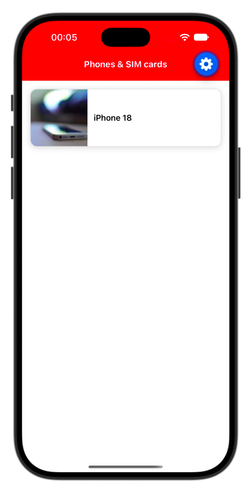
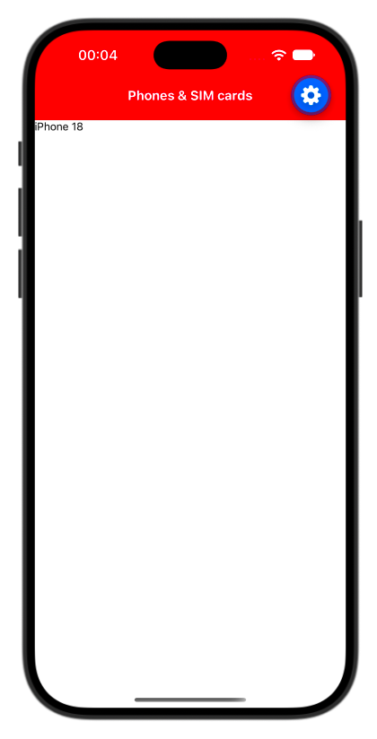
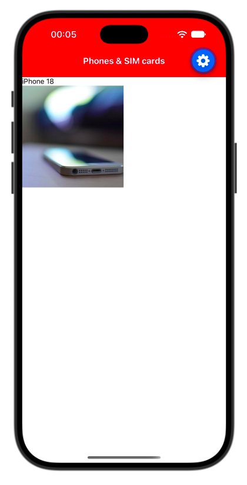
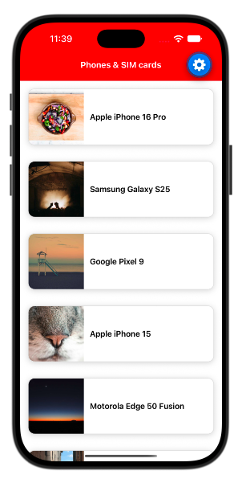
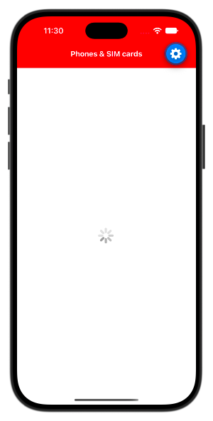
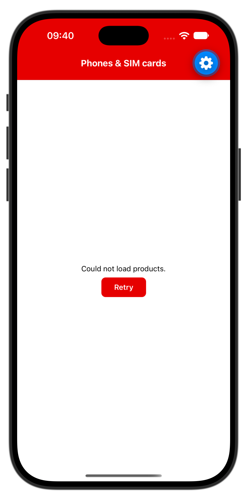
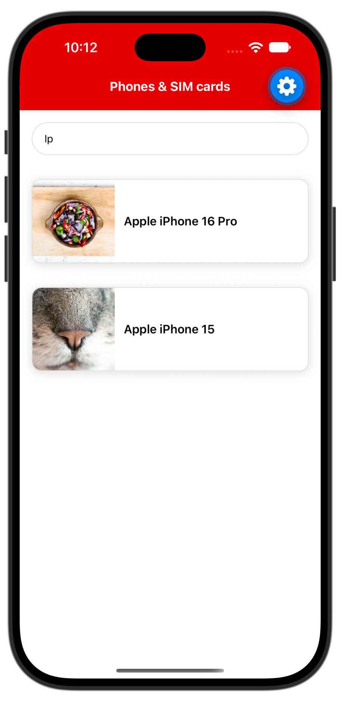
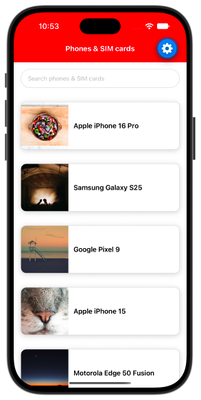
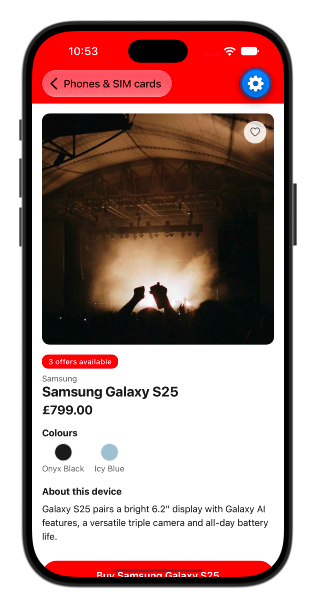
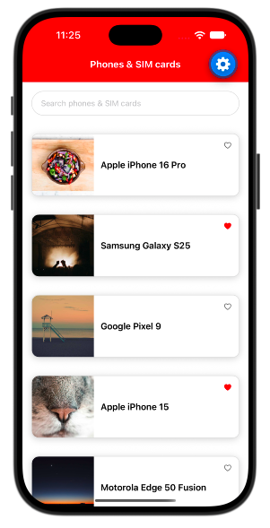

# Workshop: Phones & SIM Cards App

## Exercise 1: Installation

This is an interactive workshop. Please set up before the session. You only need to pick **one** of these options:

**Virtual device**
- Android emulator
- iOS simulator (you need a Mac)

**Real device**
- Android device
- iOS device

**Virtual development environment**
- Expo Snack: [React Native Workshop](https://snack.expo.dev/@rogoodvoda/react-native-workshop)

The demo is a React Native app run with Expo, an open-source framework built on top of React Native.

If you are stuck on an option
- Go for the emulator/simulator if you want something closest to our day to day developemnt.
- Go for Expo snack if you don't have time, or cannot install the tools.

### Step 1: Emulator, simulator or real device

1. Clone the workshop repo: https://github.com/VFUK-Digital/react_native_sample_app
2. Install the supporting tools: [Set up your environment](https://docs.expo.dev/get-started/set-up-your-environment/). You also need Node.js 20.19.4 or newer (https://nodejs.org) and Git (https://git-scm.com/downloads).
3. Then, depending on your option:
   - **Emulator or simulator:** install Xcode for the iOS simulator (Mac only), or Android Studio for the Android emulator. The setup link above walks you through it. Create a virtual device, and for iOS use iOS 16.4 or newer.
   - **Real device:** install **Expo Go** on your device (App Store or Play Store) and create an Expo account at https://expo.dev/signup. You can use any email, as this is a demo site.

### Step 2: Expo Snack

You can work directly in the Snack instead. No setup is required, and you don't need an account. This is enough for the workshop. If you use it, skip Steps 3 and 4.

### Step 3: Install the packages

From the project folder:

```bash
npm install
```

Stay on the default branch unless you are told to switch.

### Step 4: Start the app

Start the app and leave it running while you work:

- **Android emulator:** `npm run android`
- **iOS simulator:** `npm run ios`
- **Real device:**
  1. Sign in to your Expo account in the terminal:
     ```bash
     npx expo login
     ```
  2. Put your device on the same Wi-Fi network as your computer.
  3. Start the app:
     ```bash
     npm run start
     ```
  4. Scan the QR code from the terminal. On an iPhone use the Camera app. On Android open Expo Go and tap **Scan QR code**.

Expo Go is installed into an emulator or simulator for you. On a real device, sign in to the same Expo account in Expo Go, and update Expo Go if it reports a version mismatch.

You should see a header, "Phones & SIM cards", above an empty screen. Fast Refresh applies each change on save.

---

## Exercise 2: Build a product card

Build a product card from React Native's core components: `View`, `Text`, `Image` and `StyleSheet`.

<p align="center"></p>

### Open the file

Open `src/screens/ProductListScreen.tsx`.

Optional: `npm test` verifies your work. Tests for later exercises fail until you reach them. After this exercise, 9 tests pass.

Each step shows the whole file after the change. Added code is marked with `NEW` comments, which you can delete. Where most of the file changes, nothing is marked.

---

### Step 1: View and Text

`View` is the basic layout container, comparable to a `div`. 

All text must be wrapped in `<Text>`.

A bare string inside a `View` is an error.

**`src/screens/ProductListScreen.tsx`**

```tsx
import { Text, View } from 'react-native';  // UPDATED

export default function ProductListScreen() {
  // NEW
  return (
    <View>
      <Text>iPhone 18</Text>
    </View>
  );
  // END NEW
}
```

Result:

<p align="center"></p>

---

### Step 2: Image

Remote images take a `source` object with a `uri`, and need explicit dimensions. Nothing is visible until the styles in Step 3.

**`src/screens/ProductListScreen.tsx`**

```tsx
import { Image, Text, View } from 'react-native';  // UPDATED

export default function ProductListScreen() {
  return (
    <View>
      <Text>iPhone 18</Text>
      {/* NEW */}
      <Image
        source={{ uri: 'https://picsum.photos/id/160/600/600' }}
        style={{ width: 200, height: 200 }}
      />
      {/* END NEW */}
    </View>
  );
}
```

Result:

<p align="center"></p>

---

### Step 3: StyleSheet

Lay the image and text out as a single card with a shadow.

#### Notes
- Styles are JavaScript objects, and are inspired by, but not a copy of, CSS. Layout is inspired Flexbox, and is almost the same as the web. One key difference is that the default `flexDirection` is `column`.
- Shadows are platform-specific: iOS uses the `shadow-` styles (`shadowColor`, `shadowOffset`, `shadowOpacity`, `shadowRadius`) and Android uses `elevation`.
- Dimensions are unitless, in density-independent points. 
- `flex: 1` fills the remaining space in the parent.
- Colours come from the theme file `src/theme/colors.ts`, so every colour is defined in one place.

**`src/screens/ProductListScreen.tsx`**

```tsx
import { Image, StyleSheet, Text, View } from 'react-native';
import { colors } from '../theme/colors';

export default function ProductListScreen() {
  return (
    <View style={styles.container}>
      <View style={styles.card}>
        <Image
          source={{ uri: 'https://picsum.photos/id/160/120/120' }}
          style={styles.image}
        />
        <Text style={styles.name}>iPhone 18</Text>
      </View>
    </View>
  );
}

const styles = StyleSheet.create({
  container: {
    flex: 1,
    backgroundColor: colors.background,
  },
  card: {
    flexDirection: 'row',
    alignItems: 'center',
    margin: 16,
    borderRadius: 12,
    borderWidth: 1,
    borderColor: colors.borderStrong,
    backgroundColor: colors.background,
    shadowColor: '#000',
    shadowOffset: { width: 0, height: 2 },
    shadowOpacity: 0.15,
    shadowRadius: 6,
    elevation: 4,
  },
  image: {
    width: 110,
    height: 110,
    borderTopLeftRadius: 12,
    borderBottomLeftRadius: 12,
  },
  name: { 
    flex: 1, 
    padding: 12, 
    fontSize: 16,
    fontWeight: '600'
  },
});
```

Result:

<p align="center"></p>

---

## Exercise 3: Load the products

Fetch the products and render them in a list, with loading and error states. This exercise needs the repo; it does not work in Expo Snack.

---

### Step 1: Data fetching

We will load products from an api into a `FlatList`. 

The data layer is already provided:
- `src/data/products.json` holds the products
- `src/data/products.ts` loads them.
- `getProducts()` in `src/services/productsService.ts` returns them after a 2 second delay, to simulate a slow network call.

**Render the list.**

**`src/screens/ProductListScreen.tsx`**

```tsx
import { FlatList, Image, StyleSheet, Text, View } from 'react-native'; //UPDATED
import { colors } from '../theme/colors';

// NEW
import { useEffect, useState } from 'react';
import { getProducts } from '../services/productsService';
import { Product } from '../types/product';
// END NEW

export default function ProductListScreen() {
  // NEW
  const [products, setProducts] = useState<Product[]>([]);

  useEffect(() => {
    getProducts().then(setProducts);
  }, []);
  // END NEW

  return (
    <View style={styles.container}>
      {/* NEW */}
      <FlatList
        data={products}
        keyExtractor={(item) => item.id}
        renderItem={({ item }) => (
          <View style={styles.card}>
            <Image
              source={{ uri: item.image }}
              style={styles.image}
            />
            <Text style={styles.name}>{item.name}</Text>
          </View>
        )}
      />
      {/* END NEW */}
    </View>
  );
}

const styles = StyleSheet.create({
  container: {
    flex: 1,
    backgroundColor: colors.background,
  },
  card: {
    flexDirection: 'row',
    alignItems: 'center',
    margin: 16,
    borderRadius: 12,
    borderWidth: 1,
    borderColor: colors.borderStrong,
    backgroundColor: colors.background,
    shadowColor: '#000',
    shadowOffset: { width: 0, height: 2 },
    shadowOpacity: 0.15,
    shadowRadius: 6,
    elevation: 4,
  },
  image: {
    width: 110,
    height: 110,
    borderTopLeftRadius: 12,
    borderBottomLeftRadius: 12,
  },
  name: { flex: 1, padding: 12, fontSize: 16, fontWeight: '600' },
});
```

Result:

<p align="center"></p>

---

### Step 2: Loading Indicator

Real data takes time, so show a spinner while it loads. `ActivityIndicator` is the native spinner. `size="large"` makes it bigger, and `flex: 1` centres it in the available space.

While `loading` is true, return the spinner on its own. A component can return early like this, which keeps the main `return` for the finished list.

**`src/screens/ProductListScreen.tsx`**

```tsx
import { useEffect, useState } from 'react';
import { ActivityIndicator, FlatList, Image, StyleSheet, Text, View } from 'react-native';  // NEW
import { getProducts } from '../services/productsService';
import { colors } from '../theme/colors';
import { Product } from '../types/product';

export default function ProductListScreen() {
  const [products, setProducts] = useState<Product[]>([]);
  const [loading, setLoading] = useState<boolean>(true);  // NEW

  useEffect(() => {
    // NEW
    getProducts()
      .then(setProducts)
      .finally(() => setLoading(false));
    // END NEW
  }, []);

  // NEW
  if (loading) {
    return (
      <View style={styles.container}>
        <ActivityIndicator size="large" style={styles.loader} />
      </View>
    );
  }
  // END NEW

  return (
    <View style={styles.container}>
      <FlatList
        data={products}
        keyExtractor={(item) => item.id}
        renderItem={({ item }) => (
          <View style={styles.card}>
            <Image
              source={{ uri: item.image }}
              style={styles.image}
            />
            <Text style={styles.name}>{item.name}</Text>
          </View>
        )}
      />
    </View>
  );
}

const styles = StyleSheet.create({
  container: {
    flex: 1,
    backgroundColor: colors.background,
  },
  card: {
    flexDirection: 'row',
    alignItems: 'center',
    margin: 16,
    borderRadius: 12,
    borderWidth: 1,
    borderColor: colors.borderStrong,
    backgroundColor: colors.background,
    shadowColor: '#000',
    shadowOffset: { width: 0, height: 2 },
    shadowOpacity: 0.15,
    shadowRadius: 6,
    elevation: 4,
  },
  image: {
    width: 110,
    height: 110,
    borderTopLeftRadius: 12,
    borderBottomLeftRadius: 12,
  },
  name: { flex: 1, padding: 12, fontSize: 16, fontWeight: '600' },
  loader: { flex: 1 },  // NEW
});
```

Result:

<p align="center"></p>

---

### Step 3: Errors

Loading can also fail. Return an error message and a **Retry** button in the same way. `Pressable` is the touch wrapper, covered in the next exercise.

**Try it:** to see the error state, temporarily replace the body of `getProducts` in `productsService.ts` with the following, then restore it:

```ts
return new Promise((_resolve, reject) => {
  setTimeout(() => reject(new Error('Network down')), 2000);
});
```

**`src/screens/ProductListScreen.tsx`**

```tsx
import { useEffect, useState } from 'react';
import { ActivityIndicator, FlatList, Image, Pressable, StyleSheet, Text, View } from 'react-native';  // UPDATED
import { getProducts } from '../services/productsService';
import { colors } from '../theme/colors';
import { Product } from '../types/product';

export default function ProductListScreen() {
  const [products, setProducts] = useState<Product[]>([]);
  const [loading, setLoading] = useState<boolean>(true);
  // NEW
  const [error, setError] = useState<boolean>(false);

  function loadProducts() {
    setLoading(true);
    setError(false);
    getProducts()
      .then(setProducts)
      .catch(() => setError(true))
      .finally(() => setLoading(false));
  }
  // END NEW

  useEffect(() => {
    loadProducts();  // UPDATED
  }, []);

  if (loading) {
    return (
      <View style={styles.container}>
        <ActivityIndicator size="large" style={styles.loader} />
      </View>
    );
  }

  // NEW
  if (error) {
    return (
      <View style={styles.message}>
        <Text>Could not load products.</Text>
        <Pressable style={styles.retryButton} onPress={loadProducts}>
          <Text style={styles.retryText}>Retry</Text>
        </Pressable>
      </View>
    );
  }
  // END NEW

  return (
    <View style={styles.container}>
      <FlatList
        data={products}
        keyExtractor={(item) => item.id}
        renderItem={({ item }) => (
          <View style={styles.card}>
            <Image
              source={{ uri: item.image }}
              style={styles.image}
            />
            <Text style={styles.name}>{item.name}</Text>
          </View>
        )}
      />
    </View>
  );
}

const styles = StyleSheet.create({
  container: {
    flex: 1,
    backgroundColor: colors.background,
  },
  card: {
    flexDirection: 'row',
    alignItems: 'center',
    margin: 16,
    borderRadius: 12,
    borderWidth: 1,
    borderColor: colors.borderStrong,
    backgroundColor: colors.background,
    shadowColor: '#000',
    shadowOffset: { width: 0, height: 2 },
    shadowOpacity: 0.15,
    shadowRadius: 6,
    elevation: 4,
  },
  image: {
    width: 110,
    height: 110,
    borderTopLeftRadius: 12,
    borderBottomLeftRadius: 12,
  },
  name: { flex: 1, padding: 12, fontSize: 16, fontWeight: '600' },
  loader: { flex: 1 },
  // NEW
  message: { flex: 1, alignItems: 'center', justifyContent: 'center', gap: 8, padding: 16 },
  retryButton: {
    backgroundColor: colors.primary,
    minHeight: 44,
    justifyContent: 'center',
    paddingHorizontal: 24,
    paddingVertical: 10,
    borderRadius: 8,
  },
  retryText: { color: colors.badgeText, fontWeight: '600' },
  // END NEW
});
```

Result:

<p align="center"></p>

Optional: `npm test` should now show 11 tests passing.

---

## Exercise 4: Add interactivity

Add search to the list: a text field and state. This exercise needs the repo; it does not work in Expo Snack.

---

### Step 1: Interactivity

`TextInput` is the text field. Connect it to state and the list filters as you type. Type "pixel" and the list narrows.

`onChangeText` passes the new string, not an event object.

`keyboardType` chooses which on-screen keyboard appears. `"default"` is the normal text keyboard, which suits a search box. Other values include `"numeric"`, `"email-address"`, `"phone-pad"` and `"url"`. Match the keyboard to the data you expect.

`Pressable` is the generic touch target. You already used it for the Retry button: there is no `onClick`, and `onPress` fires on a tap. React Native's built-in `Button` renders as plain text on iOS and can't be styled much, which is why the Retry button is a `Pressable` with a `Text` inside.

**`src/screens/ProductListScreen.tsx`**

```tsx
import { useEffect, useState } from 'react';
// NEW
import {
  ActivityIndicator,
  FlatList,
  Image,
  Pressable,
  StyleSheet,
  Text,
  TextInput,
  View,
} from 'react-native';
// END NEW
import { getProducts } from '../services/productsService';
import { colors } from '../theme/colors';
import { Product } from '../types/product';

export default function ProductListScreen() {
  const [query, setQuery] = useState<string>('');  // NEW
  const [products, setProducts] = useState<Product[]>([]);
  const [loading, setLoading] = useState<boolean>(true);
  const [error, setError] = useState<boolean>(false);

  function loadProducts() {
    setLoading(true);
    setError(false);
    getProducts()
      .then(setProducts)
      .catch(() => setError(true))
      .finally(() => setLoading(false));
  }

  useEffect(() => {
    loadProducts();
  }, []);

  if (loading) {
    return (
      <View style={styles.container}>
        <ActivityIndicator size="large" style={styles.loader} />
      </View>
    );
  }

  if (error) {
    return (
      <View style={styles.message}>
        <Text>Could not load products.</Text>
        <Pressable style={styles.retryButton} onPress={loadProducts}>
          <Text style={styles.retryText}>Retry</Text>
        </Pressable>
      </View>
    );
  }

  // NEW
  const filteredProducts = products.filter((product) =>
    product.name.toLowerCase().includes(query.trim().toLowerCase())
  );
  // END NEW

  return (
    <View style={styles.container}>
      {/* NEW */}
      <TextInput
        value={query}
        onChangeText={setQuery}
        placeholder="Search phones & SIM cards"
        keyboardType="default"
        style={styles.input}
      />
      {/* END NEW */}
      <FlatList
        data={filteredProducts}  /* UPDATED */
        keyExtractor={(item) => item.id}
        renderItem={({ item }) => (
          <View style={styles.card}>
            <Image
              source={{ uri: item.image }}
              style={styles.image}
            />
            <Text style={styles.name}>{item.name}</Text>
          </View>
        )}
      />
    </View>
  );
}

const styles = StyleSheet.create({
  container: {
    flex: 1,
    backgroundColor: colors.background,
  // NEW
  },
  input: {
    minHeight: 44,
    margin: 16,
    borderWidth: 1,
    borderColor: colors.borderStrong,
    borderRadius: 22,
    paddingHorizontal: 16,
  // END NEW
  },
  card: {
    flexDirection: 'row',
    alignItems: 'center',
    margin: 16,
    borderRadius: 12,
    borderWidth: 1,
    borderColor: colors.borderStrong,
    backgroundColor: colors.background,
    shadowColor: '#000',
    shadowOffset: { width: 0, height: 2 },
    shadowOpacity: 0.15,
    shadowRadius: 6,
    elevation: 4,
  },
  image: {
    width: 110,
    height: 110,
    borderTopLeftRadius: 12,
    borderBottomLeftRadius: 12,
  },
  name: { flex: 1, padding: 12, fontSize: 16, fontWeight: '600' },
  loader: { flex: 1 },
  message: { flex: 1, alignItems: 'center', justifyContent: 'center', gap: 8, padding: 16 },
  retryButton: {
    backgroundColor: colors.primary,
    minHeight: 44,
    justifyContent: 'center',
    paddingHorizontal: 24,
    paddingVertical: 10,
    borderRadius: 8,
  },
  retryText: { color: colors.badgeText, fontWeight: '600' },
});
```

Result:

<p align="center"></p>

---

## Exercise 5: Accessibility

Make the list usable with a screen reader: VoiceOver on iOS and TalkBack on Android. This exercise needs the repo; it does not work in Expo Snack.

---

### Step 1: Accessibility labels

A screen reader reads out what is on the screen. The search box, the spinner and the product images have no visible text for it to read, so give each an `accessibilityLabel`. The screen reader reads the label instead. An image also needs `accessible`, otherwise iOS skips it.

The Retry button gets `accessibilityRole="button"` and a label that says what it does. The error message gets `accessibilityRole="alert"`, which marks it as important.

Optional, on a physical phone only:

- iOS: Settings > Accessibility > VoiceOver.
- Android: Settings > Accessibility > TalkBack > Use TalkBack.
- Both change how touch works: you select an item with one tap and activate it with a double-tap. Turn them off in the same settings screen.

Not applicable on a simulator or an emulator.

Optional, if you use Visual Studio Code: install the [axe Accessibility Linter](https://marketplace.visualstudio.com/items?itemName=deque-systems.vscode-axe-linter) extension. It flags accessibility violations in your code as you type, for example an image with no label. Open `src/screens/ProductListScreen.tsx` and look for squiggly underlines, or open the Problems panel (View > Problems). The repo's `axe-linter.yml` turns on the React Native rules. If nothing is flagged, reload the window (Command Palette > Developer: Reload Window).

**`src/screens/ProductListScreen.tsx`**

```tsx
import { useEffect, useState } from 'react';
import {
  ActivityIndicator,
  FlatList,
  Image,
  Pressable,
  StyleSheet,
  Text,
  TextInput,
  View,
} from 'react-native';
import { getProducts } from '../services/productsService';
import { colors } from '../theme/colors';
import { Product } from '../types/product';

export default function ProductListScreen() {
  const [query, setQuery] = useState<string>('');
  const [products, setProducts] = useState<Product[]>([]);
  const [loading, setLoading] = useState<boolean>(true);
  const [error, setError] = useState<boolean>(false);

  function loadProducts() {
    setLoading(true);
    setError(false);
    getProducts()
      .then(setProducts)
      .catch(() => setError(true))
      .finally(() => setLoading(false));
  }

  useEffect(() => {
    loadProducts();
  }, []);

  if (loading) {
    return (
      <View style={styles.container}>
        <ActivityIndicator
          size="large"
          style={styles.loader}
          accessibilityLabel="Loading products"  /* NEW */
        />
      </View>
    );
  }

  if (error) {
    return (
      <View style={styles.message}>
        <Text accessibilityRole="alert">Could not load products.</Text>
        <Pressable
          style={styles.retryButton}
          onPress={loadProducts}
          accessibilityRole="button"  /* NEW */
          accessibilityLabel="Retry loading products"  /* NEW */
        >
          <Text style={styles.retryText}>Retry</Text>
        </Pressable>
      </View>
    );
  }

  const filteredProducts = products.filter((product) =>
    product.name.toLowerCase().includes(query.trim().toLowerCase())
  );

  return (
    <View style={styles.container}>
      <TextInput
        value={query}
        onChangeText={setQuery}
        placeholder="Search phones & SIM cards"
        keyboardType="default"
        accessibilityLabel="Search phones"  /* NEW */
        style={styles.input}
      />
      <FlatList
        data={filteredProducts}
        keyExtractor={(item) => item.id}
        renderItem={({ item }) => (
          <View style={styles.card}>
            <Image
              source={{ uri: item.image }}
              style={styles.image}
              accessible  /* NEW */
              accessibilityLabel={item.name}  /* NEW */
            />
            <Text style={styles.name}>{item.name}</Text>
          </View>
        )}
      />
    </View>
  );
}

const styles = StyleSheet.create({
  container: {
    flex: 1,
    backgroundColor: colors.background,
  },
  input: {
    minHeight: 44,
    margin: 16,
    borderWidth: 1,
    borderColor: colors.borderStrong,
    borderRadius: 22,
    paddingHorizontal: 16,
  },
  card: {
    flexDirection: 'row',
    alignItems: 'center',
    margin: 16,
    borderRadius: 12,
    borderWidth: 1,
    borderColor: colors.borderStrong,
    backgroundColor: colors.background,
    shadowColor: '#000',
    shadowOffset: { width: 0, height: 2 },
    shadowOpacity: 0.15,
    shadowRadius: 6,
    elevation: 4,
  },
  image: {
    width: 110,
    height: 110,
    borderTopLeftRadius: 12,
    borderBottomLeftRadius: 12,
  },
  name: { flex: 1, padding: 12, fontSize: 16, fontWeight: '600' },
  loader: { flex: 1 },
  message: { flex: 1, alignItems: 'center', justifyContent: 'center', gap: 8, padding: 16 },
  retryButton: {
    backgroundColor: colors.primary,
    minHeight: 44,
    justifyContent: 'center',
    paddingHorizontal: 24,
    paddingVertical: 10,
    borderRadius: 8,
  },
  retryText: { color: colors.badgeText, fontWeight: '600' },
});
```

Optional: `npm test` should now show 12 tests passing.

---

### Step 2: A visible label and an empty state

Three more changes to the search.

- **A visible label.** A placeholder disappears as soon as you type, so add a label above the box that stays. The input already has an `accessibilityLabel`, so hide the visible one from screen readers with `accessibilityElementsHidden` (iOS) and `importantForAccessibility="no"` (Android). Otherwise it is read twice.
- **Contrast.** The default placeholder colour is too pale to read easily. `placeholderTextColor` takes a theme colour with enough contrast.
- **An empty state.** When the search matches nothing, the list is blank and a screen reader user hears nothing. `ListEmptyComponent` shows a message instead, and `accessibilityRole="alert"` marks it as important.

**`src/screens/ProductListScreen.tsx`**

```tsx
import { useEffect, useState } from 'react';
import {
  ActivityIndicator,
  FlatList,
  Image,
  Pressable,
  StyleSheet,
  Text,
  TextInput,
  View,
} from 'react-native';
import { getProducts } from '../services/productsService';
import { colors } from '../theme/colors';
import { Product } from '../types/product';

export default function ProductListScreen() {
  const [query, setQuery] = useState<string>('');
  const [products, setProducts] = useState<Product[]>([]);
  const [loading, setLoading] = useState<boolean>(true);
  const [error, setError] = useState<boolean>(false);

  function loadProducts() {
    setLoading(true);
    setError(false);
    getProducts()
      .then(setProducts)
      .catch(() => setError(true))
      .finally(() => setLoading(false));
  }

  useEffect(() => {
    loadProducts();
  }, []);

  if (loading) {
    return (
      <View style={styles.container}>
        <ActivityIndicator
          size="large"
          style={styles.loader}
          accessibilityLabel="Loading products"
        />
      </View>
    );
  }

  if (error) {
    return (
      <View style={styles.message}>
        <Text accessibilityRole="alert">Could not load products.</Text>
        <Pressable
          style={styles.retryButton}
          onPress={loadProducts}
          accessibilityRole="button"
          accessibilityLabel="Retry loading products"
        >
          <Text style={styles.retryText}>Retry</Text>
        </Pressable>
      </View>
    );
  }

  const filteredProducts = products.filter((product) =>
    product.name.toLowerCase().includes(query.trim().toLowerCase())
  );

  return (
    <View style={styles.container}>
      {/* NEW */}
      {/* A visible label that stays on screen while typing. The input has its own label, so screen readers skip this one. */}
      <Text
        style={styles.searchLabel}
        accessibilityElementsHidden
        importantForAccessibility="no"
      >
        Search phones
      </Text>
      {/* END NEW */}
      <TextInput
        value={query}
        onChangeText={setQuery}
        placeholder="Search phones & SIM cards"
        placeholderTextColor={colors.textSecondary}  /* NEW */
        keyboardType="default"
        accessibilityLabel="Search phones"
        style={styles.input}
      />
      <FlatList
        data={filteredProducts}
        keyExtractor={(item) => item.id}
        ListEmptyComponent={<Text style={styles.empty} accessibilityRole="alert">No products match your search.</Text>}  /* NEW */
        renderItem={({ item }) => (
          <View style={styles.card}>
            <Image
              source={{ uri: item.image }}
              style={styles.image}
              accessible
              accessibilityLabel={item.name}
            />
            <Text style={styles.name}>{item.name}</Text>
          </View>
        )}
      />
    </View>
  );
}

const styles = StyleSheet.create({
  container: {
    flex: 1,
    backgroundColor: colors.background,
  },
  // NEW
  searchLabel: {
    marginHorizontal: 16,
    marginTop: 16,
    fontSize: 15,
    fontWeight: '600',
    color: colors.textPrimary,
  },
  // END NEW
  input: {
    minHeight: 44,
    marginHorizontal: 16,  // UPDATED
    marginTop: 8,  // UPDATED
    marginBottom: 16,  // UPDATED
    borderWidth: 1,
    borderColor: colors.borderStrong,
    borderRadius: 22,
    paddingHorizontal: 16,
  },
  card: {
    flexDirection: 'row',
    alignItems: 'center',
    margin: 16,
    borderRadius: 12,
    borderWidth: 1,
    borderColor: colors.borderStrong,
    backgroundColor: colors.background,
    shadowColor: '#000',
    shadowOffset: { width: 0, height: 2 },
    shadowOpacity: 0.15,
    shadowRadius: 6,
    elevation: 4,
  },
  image: {
    width: 110,
    height: 110,
    borderTopLeftRadius: 12,
    borderBottomLeftRadius: 12,
  },
  name: { flex: 1, padding: 12, fontSize: 16, fontWeight: '600' },
  // NEW
  empty: { padding: 16, fontSize: 16, color: colors.textSecondary },
  // END NEW
  loader: { flex: 1 },
  message: { flex: 1, alignItems: 'center', justifyContent: 'center', gap: 8, padding: 16 },
  retryButton: {
    backgroundColor: colors.primary,
    minHeight: 44,
    justifyContent: 'center',
    paddingHorizontal: 24,
    paddingVertical: 10,
    borderRadius: 8,
  },
  retryText: { color: colors.badgeText, fontWeight: '600' },
});
```

---

### Step 3: Other accessibility techniques

The finished app uses a few more techniques. You do not need to add them now.

- **Roles.** `accessibilityRole` says what an element is: `"button"` for the cards and the Retry button, `"header"` for headings, and `"alert"` for error messages.
- **Labels that describe the action.** A card is labelled "View details for Samsung Galaxy S25", not just the name.
- **Grouping.** A `Pressable` is read as one element, so anything inside it cannot be reached separately. Keep that in mind when you put a button inside a card.
- **Text that grows.** `minHeight` and `minWidth` instead of fixed `height` and `width` stop large text sizes being clipped. The search box, the Retry button and the heart use them.
- **Contrast.** The theme colours meet the WCAG AA contrast ratios: 4.5:1 for text and 3:1 for borders and icons.

These come with the favourites in Exercise 7:

- **`hitSlop`** makes a small button easier to hit.
- **`accessibilityState`** tells the screen reader about a state such as selected, checked, disabled or busy.
- **`accessibilityActions`** adds a custom action to the card, so a screen reader user can favourite a product without reaching the heart.

---

## Exercise 6: Navigation

Navigate from the list to a product's details. This exercise needs the repo; it does not work in Expo Snack.

---

### Step 1: Navigation

`src/App.tsx` is already built, and so is `ProductDetailsScreen`. You only need to navigate to it. Read `App.tsx` first, because it explains where the `navigation` prop comes from:

```tsx
const Stack = createNativeStackNavigator<RootStackParamList>();

export default function App() {
  return (
    <NavigationContainer>
      <Stack.Navigator
        initialRouteName="ProductList"
        screenOptions={{
          headerStyle: { backgroundColor: colors.primary },
          headerTintColor: colors.badgeText,
          headerTitleStyle: { fontWeight: '700' },
          contentStyle: { backgroundColor: colors.background },
        }}
      >
        <Stack.Screen name="ProductList" component={ProductListScreen} options={{ title: 'Phones & SIM cards' }} />
        <Stack.Screen name="ProductDetails" component={ProductDetailsScreen} options={{ title: '' }} />
      </Stack.Navigator>
    </NavigationContainer>
  );
}
```

- `index.ts` hands `App` to Expo with `registerRootComponent`. That is the entry point of the whole app.
- `NavigationContainer` holds the navigation state. Everything that navigates must be inside it.
- `createNativeStackNavigator` makes a stack of screens that uses the platform's native navigation. Pushing a screen slides it in, and the header gets a back button. `<RootStackParamList>` types the route names and their params, from `src/types/navigation.ts`.
- `Stack.Navigator` runs the stack. `initialRouteName` is the first screen. `screenOptions` apply to every screen, here the header colours.
- Each `Stack.Screen` registers one screen. `name` is the route name you pass to `navigation.navigate`, `component` is the screen, and `options.title` is the header text.
- The navigator passes `navigation` and `route` to every screen as props. That is how the list screen can open the details screen.

The heart on the details screen does not save yet. That comes in Exercise 7.

On Android, the system back gesture or button returns to the list.

Each screen receives a `navigation` prop. `navigation.navigate('ProductDetails', { id })` opens the details screen and passes it the product `id`.

The list screen's props type, `ProductListScreenProps`, is already defined in `src/types/navigation.ts`, next to `RootStackParamList`.

Then make the card a `Pressable` that navigates on press. A `Pressable` is read as one element, so the image no longer needs its own `accessible` or `accessibilityLabel`: the screen reader reads the product name from the card.

**`src/screens/ProductListScreen.tsx`**

```tsx
import { useEffect, useState } from 'react';
import {
  ActivityIndicator,
  FlatList,
  Image,
  Pressable,
  StyleSheet,
  Text,
  TextInput,
  View,
} from 'react-native';
import { getProducts } from '../services/productsService';
import type { ProductListScreenProps } from '../types/navigation';  // NEW
import { colors } from '../theme/colors';
import { Product } from '../types/product';

export default function ProductListScreen({ navigation }: Readonly<ProductListScreenProps>) {  // UPDATED
  const [query, setQuery] = useState<string>('');
  const [products, setProducts] = useState<Product[]>([]);
  const [loading, setLoading] = useState<boolean>(true);
  const [error, setError] = useState<boolean>(false);

  function loadProducts() {
    setLoading(true);
    setError(false);
    getProducts()
      .then(setProducts)
      .catch(() => setError(true))
      .finally(() => setLoading(false));
  }

  useEffect(() => {
    loadProducts();
  }, []);

  if (loading) {
    return (
      <View style={styles.container}>
        <ActivityIndicator
          size="large"
          style={styles.loader}
          accessibilityLabel="Loading products"
        />
      </View>
    );
  }

  if (error) {
    return (
      <View style={styles.message}>
        <Text accessibilityRole="alert">Could not load products.</Text>
        <Pressable
          style={styles.retryButton}
          onPress={loadProducts}
          accessibilityRole="button"
          accessibilityLabel="Retry loading products"
        >
          <Text style={styles.retryText}>Retry</Text>
        </Pressable>
      </View>
    );
  }

  const filteredProducts = products.filter((product) =>
    product.name.toLowerCase().includes(query.trim().toLowerCase())
  );

  return (
    <View style={styles.container}>
      <Text
        style={styles.searchLabel}
        accessibilityElementsHidden
        importantForAccessibility="no"
      >
        Search phones
      </Text>
      <TextInput
        value={query}
        onChangeText={setQuery}
        placeholder="Search phones & SIM cards"
        placeholderTextColor={colors.textSecondary}
        keyboardType="default"
        accessibilityLabel="Search phones"
        style={styles.input}
      />
      <FlatList
        data={filteredProducts}
        keyExtractor={(item) => item.id}
        ListEmptyComponent={<Text style={styles.empty} accessibilityRole="alert">No products match your search.</Text>}
        renderItem={({ item }) => (
          // NEW
          <Pressable
            style={styles.card}
            onPress={() => navigation.navigate('ProductDetails', { id: item.id })}
          >
          {/* END NEW */}
            <Image
              source={{ uri: item.image }}
              style={styles.image}
            />
            <Text style={styles.name}>{item.name}</Text>
          </Pressable>  // UPDATED
        )}
      />
    </View>
  );
}

const styles = StyleSheet.create({
  container: {
    flex: 1,
    backgroundColor: colors.background,
  },
  searchLabel: {
    marginHorizontal: 16,
    marginTop: 16,
    fontSize: 15,
    fontWeight: '600',
    color: colors.textPrimary,
  },
  input: {
    minHeight: 44,
    marginHorizontal: 16,
    marginTop: 8,
    marginBottom: 16,
    borderWidth: 1,
    borderColor: colors.borderStrong,
    borderRadius: 22,
    paddingHorizontal: 16,
  },
  card: {
    flexDirection: 'row',
    alignItems: 'center',
    margin: 16,
    borderRadius: 12,
    borderWidth: 1,
    borderColor: colors.borderStrong,
    backgroundColor: colors.background,
    shadowColor: '#000',
    shadowOffset: { width: 0, height: 2 },
    shadowOpacity: 0.15,
    shadowRadius: 6,
    elevation: 4,
  },
  image: {
    width: 110,
    height: 110,
    borderTopLeftRadius: 12,
    borderBottomLeftRadius: 12,
  },
  name: { flex: 1, padding: 12, fontSize: 16, fontWeight: '600' },
  empty: { padding: 16, fontSize: 16, color: colors.textSecondary },
  loader: { flex: 1 },
  message: { flex: 1, alignItems: 'center', justifyContent: 'center', gap: 8, padding: 16 },
  retryButton: {
    backgroundColor: colors.primary,
    minHeight: 44,
    justifyContent: 'center',
    paddingHorizontal: 24,
    paddingVertical: 10,
    borderRadius: 8,
  },
  retryText: { color: colors.badgeText, fontWeight: '600' },
});
```

Result: tap a product to open its details, then go back.

<p align="center"></p>

<p align="center"></p>

Optional: `npm test` should now show 14 tests passing.

---

## Exercise 7: Storage

Persist favourites across app restarts. The details screen already uses them. This exercise needs the repo; it does not work in Expo Snack.

The service in `src/services/productsService.ts` already has the favourites functions. `getFavouriteIds()` reads the saved ids, and `toggleFavourite(id)` adds or removes an id and saves the new list. They use two storage helpers at the bottom of the file, which you write in Step 1. You also build the heart, the list wiring and the accessibility for both.

---

### Step 1: Storage

`AsyncStorage` is an async key-value store, comparable to `localStorage`. It is already installed and stores strings only, so the ids are saved as JSON.

`loadFavouriteIds` and `saveFavouriteIds` at the bottom of the file are stubs. Until you fill them in, `toggleFavourite` has nothing to read, so only the last heart you tap stays filled.

**`src/services/productsService.ts`**

```ts
import AsyncStorage from '@react-native-async-storage/async-storage';  // NEW
import { products } from '../data/products';
import { Product } from '../types/product';

const FAVOURITES_KEY = 'favouriteProductIds';  // NEW

export function getProducts(): Promise<Product[]> {
  return new Promise((resolve) => {
    setTimeout(() => resolve(products), 2000);
  });
}

export function getFavouriteIds(): Promise<string[]> {
  return loadFavouriteIds();
}

export async function toggleFavourite(productId: string): Promise<string[]> {
  const current = await loadFavouriteIds();
  const next = current.includes(productId)
    ? current.filter((id) => id !== productId)
    : [...current, productId];
  await saveFavouriteIds(next);
  return next;
}

async function loadFavouriteIds(): Promise<string[]> {
  // NEW
  try {
    const stored = await AsyncStorage.getItem(FAVOURITES_KEY);
    return stored ? JSON.parse(stored) : [];
  } catch {
    return [];
  }
  // END NEW
}

// NEW
async function saveFavouriteIds(ids: string[]): Promise<void> {
  try {
    await AsyncStorage.setItem(FAVOURITES_KEY, JSON.stringify(ids));
  } catch {
    // Saving favourites is best effort in this demo.
  }
}
// END NEW
```

---

### Step 2: The heart

Add a heart button to each card. The inner `Pressable` handles the touch, so the card's `onPress` does not fire. Tapping the heart toggles the favourite and saves it. `FlatList` is a pure component, so `extraData` tells it to re-render when the favourites change.

The heart is a toggle, so it also gets an `accessibilityState`. `selected` says whether it is on, and a screen reader tells the user when the favourite is selected. The label stays the same and only the state changes. The other states are `checked`, `disabled`, `busy` and `expanded`.

**`src/screens/ProductListScreen.tsx`**

```tsx
import { useEffect, useState } from 'react';
import {
  ActivityIndicator,
  FlatList,
  Image,
  Pressable,
  StyleSheet,
  Text,
  TextInput,
  View,
} from 'react-native';
import { getProducts, toggleFavourite } from '../services/productsService';  // UPDATED
import type { ProductListScreenProps } from '../types/navigation';
import { colors } from '../theme/colors';
import { Product } from '../types/product';

export default function ProductListScreen({ navigation }: Readonly<ProductListScreenProps>) {
  const [query, setQuery] = useState<string>('');
  const [products, setProducts] = useState<Product[]>([]);
  const [favouriteIds, setFavouriteIds] = useState<string[]>([]);  // NEW
  const [loading, setLoading] = useState<boolean>(true);
  const [error, setError] = useState<boolean>(false);

  function loadProducts() {
    setLoading(true);
    setError(false);
    getProducts()
      .then(setProducts)
      .catch(() => setError(true))
      .finally(() => setLoading(false));
  }

  useEffect(() => {
    loadProducts();
  }, []);

  if (loading) {
    return (
      <View style={styles.container}>
        <ActivityIndicator
          size="large"
          style={styles.loader}
          accessibilityLabel="Loading products"
        />
      </View>
    );
  }

  if (error) {
    return (
      <View style={styles.message}>
        <Text accessibilityRole="alert">Could not load products.</Text>
        <Pressable
          style={styles.retryButton}
          onPress={loadProducts}
          accessibilityRole="button"
          accessibilityLabel="Retry loading products"
        >
          <Text style={styles.retryText}>Retry</Text>
        </Pressable>
      </View>
    );
  }

  const filteredProducts = products.filter((product) =>
    product.name.toLowerCase().includes(query.trim().toLowerCase())
  );

  return (
    <View style={styles.container}>
      <Text
        style={styles.searchLabel}
        accessibilityElementsHidden
        importantForAccessibility="no"
      >
        Search phones
      </Text>
      <TextInput
        value={query}
        onChangeText={setQuery}
        placeholder="Search phones & SIM cards"
        placeholderTextColor={colors.textSecondary}
        keyboardType="default"
        accessibilityLabel="Search phones"
        style={styles.input}
      />
      <FlatList
        data={filteredProducts}
        extraData={favouriteIds}  /* NEW */
        keyExtractor={(item) => item.id}
        ListEmptyComponent={<Text style={styles.empty} accessibilityRole="alert">No products match your search.</Text>}
        renderItem={({ item }) => {  /* UPDATED */
          // NEW
          const isFavourite = favouriteIds.includes(item.id);
          // END NEW

          return (
            <Pressable
              style={styles.card}
              onPress={() => navigation.navigate('ProductDetails', { id: item.id })}
            >
              <Image
                source={{ uri: item.image }}
                style={styles.image}
              />
              <Text style={styles.name}>{item.name}</Text>
              {/* NEW */}
              <Pressable
                style={styles.favouriteButton}
                onPress={() => toggleFavourite(item.id).then(setFavouriteIds)}
                accessibilityRole="button"
                accessibilityLabel={`Favourite ${item.name}`}
                accessibilityState={{ selected: isFavourite }}
              >
                <Text style={[styles.favouriteIcon, isFavourite && styles.favouriteIconActive]}>
                  {isFavourite ? '♥' : '♡'}
                </Text>
              </Pressable>
              {/* END NEW */}
            </Pressable>
          );
        }}
      />
    </View>
  );
}

const styles = StyleSheet.create({
  container: {
    flex: 1,
    backgroundColor: colors.background,
  },
  searchLabel: {
    marginHorizontal: 16,
    marginTop: 16,
    fontSize: 15,
    fontWeight: '600',
    color: colors.textPrimary,
  },
  input: {
    minHeight: 44,
    marginHorizontal: 16,
    marginTop: 8,
    marginBottom: 16,
    borderWidth: 1,
    borderColor: colors.borderStrong,
    borderRadius: 22,
    paddingHorizontal: 16,
  },
  card: {
    flexDirection: 'row',
    alignItems: 'center',
    margin: 16,
    borderRadius: 12,
    borderWidth: 1,
    borderColor: colors.borderStrong,
    backgroundColor: colors.background,
    shadowColor: '#000',
    shadowOffset: { width: 0, height: 2 },
    shadowOpacity: 0.15,
    shadowRadius: 6,
    elevation: 4,
  },
  image: {
    width: 110,
    height: 110,
    borderTopLeftRadius: 12,
    borderBottomLeftRadius: 12,
  },
  // paddingRight keeps long names clear of the heart in the top-right corner.
  name: { flex: 1, padding: 12, paddingRight: 44, fontSize: 16, fontWeight: '600' },  // UPDATED
  empty: { padding: 16, fontSize: 16, color: colors.textSecondary },
  // NEW
  favouriteButton: {
    position: 'absolute',
    top: 6,
    right: 6,
    minWidth: 28,
    minHeight: 28,
    borderRadius: 14,
    backgroundColor: 'rgba(255,255,255,0.85)',
    alignItems: 'center',
    justifyContent: 'center',
  },
  favouriteIcon: { fontSize: 16, color: colors.textSecondary },
  favouriteIconActive: { color: colors.primary },
  // END NEW
  loader: { flex: 1 },
  message: { flex: 1, alignItems: 'center', justifyContent: 'center', gap: 8, padding: 16 },
  retryButton: {
    backgroundColor: colors.primary,
    minHeight: 44,
    justifyContent: 'center',
    paddingHorizontal: 24,
    paddingVertical: 10,
    borderRadius: 8,
  },
  retryText: { color: colors.badgeText, fontWeight: '600' },
});
```

Result:

<p align="center"></p>

---

### Step 3: Bigger touch target

The heart is only 28 points wide, which is easy to miss with a thumb. `hitSlop` extends the touchable area beyond the visible button by the given number of points on every side. It doesn't change the layout.

**`src/screens/ProductListScreen.tsx`**

```tsx
import { useEffect, useState } from 'react';
import {
  ActivityIndicator,
  FlatList,
  Image,
  Pressable,
  StyleSheet,
  Text,
  TextInput,
  View,
} from 'react-native';
import { getProducts, toggleFavourite } from '../services/productsService';
import type { ProductListScreenProps } from '../types/navigation';
import { colors } from '../theme/colors';
import { Product } from '../types/product';

export default function ProductListScreen({ navigation }: Readonly<ProductListScreenProps>) {
  const [query, setQuery] = useState<string>('');
  const [products, setProducts] = useState<Product[]>([]);
  const [favouriteIds, setFavouriteIds] = useState<string[]>([]);
  const [loading, setLoading] = useState<boolean>(true);
  const [error, setError] = useState<boolean>(false);

  function loadProducts() {
    setLoading(true);
    setError(false);
    getProducts()
      .then(setProducts)
      .catch(() => setError(true))
      .finally(() => setLoading(false));
  }

  useEffect(() => {
    loadProducts();
  }, []);

  if (loading) {
    return (
      <View style={styles.container}>
        <ActivityIndicator
          size="large"
          style={styles.loader}
          accessibilityLabel="Loading products"
        />
      </View>
    );
  }

  if (error) {
    return (
      <View style={styles.message}>
        <Text accessibilityRole="alert">Could not load products.</Text>
        <Pressable
          style={styles.retryButton}
          onPress={loadProducts}
          accessibilityRole="button"
          accessibilityLabel="Retry loading products"
        >
          <Text style={styles.retryText}>Retry</Text>
        </Pressable>
      </View>
    );
  }

  const filteredProducts = products.filter((product) =>
    product.name.toLowerCase().includes(query.trim().toLowerCase())
  );

  return (
    <View style={styles.container}>
      <Text
        style={styles.searchLabel}
        accessibilityElementsHidden
        importantForAccessibility="no"
      >
        Search phones
      </Text>
      <TextInput
        value={query}
        onChangeText={setQuery}
        placeholder="Search phones & SIM cards"
        placeholderTextColor={colors.textSecondary}
        keyboardType="default"
        accessibilityLabel="Search phones"
        style={styles.input}
      />
      <FlatList
        data={filteredProducts}
        extraData={favouriteIds}
        keyExtractor={(item) => item.id}
        ListEmptyComponent={<Text style={styles.empty} accessibilityRole="alert">No products match your search.</Text>}
        renderItem={({ item }) => {
          const isFavourite = favouriteIds.includes(item.id);

          return (
            <Pressable
              style={styles.card}
              onPress={() => navigation.navigate('ProductDetails', { id: item.id })}
            >
              <Image
                source={{ uri: item.image }}
                style={styles.image}
              />
              <Text style={styles.name}>{item.name}</Text>
              <Pressable
                style={styles.favouriteButton}
                hitSlop={8}  /* NEW */
                onPress={() => toggleFavourite(item.id).then(setFavouriteIds)}
                accessibilityRole="button"
                accessibilityLabel={`Favourite ${item.name}`}
                accessibilityState={{ selected: isFavourite }}
              >
                <Text style={[styles.favouriteIcon, isFavourite && styles.favouriteIconActive]}>
                  {isFavourite ? '♥' : '♡'}
                </Text>
              </Pressable>
            </Pressable>
          );
        }}
      />
    </View>
  );
}

const styles = StyleSheet.create({
  container: {
    flex: 1,
    backgroundColor: colors.background,
  },
  searchLabel: {
    marginHorizontal: 16,
    marginTop: 16,
    fontSize: 15,
    fontWeight: '600',
    color: colors.textPrimary,
  },
  input: {
    minHeight: 44,
    marginHorizontal: 16,
    marginTop: 8,
    marginBottom: 16,
    borderWidth: 1,
    borderColor: colors.borderStrong,
    borderRadius: 22,
    paddingHorizontal: 16,
  },
  card: {
    flexDirection: 'row',
    alignItems: 'center',
    margin: 16,
    borderRadius: 12,
    borderWidth: 1,
    borderColor: colors.borderStrong,
    backgroundColor: colors.background,
    shadowColor: '#000',
    shadowOffset: { width: 0, height: 2 },
    shadowOpacity: 0.15,
    shadowRadius: 6,
    elevation: 4,
  },
  image: {
    width: 110,
    height: 110,
    borderTopLeftRadius: 12,
    borderBottomLeftRadius: 12,
  },
  // paddingRight keeps long names clear of the heart in the top-right corner.
  name: { flex: 1, padding: 12, paddingRight: 44, fontSize: 16, fontWeight: '600' },
  empty: { padding: 16, fontSize: 16, color: colors.textSecondary },
  favouriteButton: {
    position: 'absolute',
    top: 6,
    right: 6,
    minWidth: 28,
    minHeight: 28,
    borderRadius: 14,
    backgroundColor: 'rgba(255,255,255,0.85)',
    alignItems: 'center',
    justifyContent: 'center',
  },
  favouriteIcon: { fontSize: 16, color: colors.textSecondary },
  favouriteIconActive: { color: colors.primary },
  loader: { flex: 1 },
  message: { flex: 1, alignItems: 'center', justifyContent: 'center', gap: 8, padding: 16 },
  retryButton: {
    backgroundColor: colors.primary,
    minHeight: 44,
    justifyContent: 'center',
    paddingHorizontal: 24,
    paddingVertical: 10,
    borderRadius: 8,
  },
  retryText: { color: colors.badgeText, fontWeight: '600' },
});
```

---

### Step 4: Connect the list

Load favourites whenever the screen is focused, so saved favourites appear on start and after you return from the details screen.

- The list screen stays mounted under the details screen, so `useEffect` would not run again on return. `useFocusEffect` runs on every focus.
- `useFocusEffect` needs a memoised callback, hence `useCallback`.

**`src/screens/ProductListScreen.tsx`**

```tsx
// NEW
import { useFocusEffect } from '@react-navigation/native';
import { useCallback, useEffect, useState } from 'react';
// END NEW
import {
  ActivityIndicator,
  FlatList,
  Image,
  Pressable,
  StyleSheet,
  Text,
  TextInput,
  View,
} from 'react-native';
import { getFavouriteIds, getProducts, toggleFavourite } from '../services/productsService';  // UPDATED
import type { ProductListScreenProps } from '../types/navigation';
import { colors } from '../theme/colors';
import { Product } from '../types/product';

export default function ProductListScreen({ navigation }: Readonly<ProductListScreenProps>) {
  const [query, setQuery] = useState<string>('');
  const [products, setProducts] = useState<Product[]>([]);
  const [favouriteIds, setFavouriteIds] = useState<string[]>([]);
  const [loading, setLoading] = useState<boolean>(true);
  const [error, setError] = useState<boolean>(false);

  function loadProducts() {
    setLoading(true);
    setError(false);
    getProducts()
      .then(setProducts)
      .catch(() => setError(true))
      .finally(() => setLoading(false));
  }

  useEffect(() => {
    loadProducts();
  }, []);

  // NEW
  useFocusEffect(
    useCallback(() => {
      getFavouriteIds()
        .then(setFavouriteIds)
        .catch(() => { /* This would normally be handled by a toast or some user notification. Out of scope. */ });
    }, [])
  );
  // END NEW

  if (loading) {
    return (
      <View style={styles.container}>
        <ActivityIndicator
          size="large"
          style={styles.loader}
          accessibilityLabel="Loading products"
        />
      </View>
    );
  }

  if (error) {
    return (
      <View style={styles.message}>
        <Text accessibilityRole="alert">Could not load products.</Text>
        <Pressable
          style={styles.retryButton}
          onPress={loadProducts}
          accessibilityRole="button"
          accessibilityLabel="Retry loading products"
        >
          <Text style={styles.retryText}>Retry</Text>
        </Pressable>
      </View>
    );
  }

  const filteredProducts = products.filter((product) =>
    product.name.toLowerCase().includes(query.trim().toLowerCase())
  );

  return (
    <View style={styles.container}>
      <Text
        style={styles.searchLabel}
        accessibilityElementsHidden
        importantForAccessibility="no"
      >
        Search phones
      </Text>
      <TextInput
        value={query}
        onChangeText={setQuery}
        placeholder="Search phones & SIM cards"
        placeholderTextColor={colors.textSecondary}
        keyboardType="default"
        accessibilityLabel="Search phones"
        style={styles.input}
      />
      <FlatList
        data={filteredProducts}
        extraData={favouriteIds}
        keyExtractor={(item) => item.id}
        ListEmptyComponent={<Text style={styles.empty} accessibilityRole="alert">No products match your search.</Text>}
        renderItem={({ item }) => {
          const isFavourite = favouriteIds.includes(item.id);

          return (
            <Pressable
              style={styles.card}
              onPress={() => navigation.navigate('ProductDetails', { id: item.id })}
            >
              <Image
                source={{ uri: item.image }}
                style={styles.image}
              />
              <Text style={styles.name}>{item.name}</Text>
              <Pressable
                style={styles.favouriteButton}
                hitSlop={8}
                onPress={() => toggleFavourite(item.id).then(setFavouriteIds)}
                accessibilityRole="button"
                accessibilityLabel={`Favourite ${item.name}`}
                accessibilityState={{ selected: isFavourite }}
              >
                <Text style={[styles.favouriteIcon, isFavourite && styles.favouriteIconActive]}>
                  {isFavourite ? '♥' : '♡'}
                </Text>
              </Pressable>
            </Pressable>
          );
        }}
      />
    </View>
  );
}

const styles = StyleSheet.create({
  container: {
    flex: 1,
    backgroundColor: colors.background,
  },
  searchLabel: {
    marginHorizontal: 16,
    marginTop: 16,
    fontSize: 15,
    fontWeight: '600',
    color: colors.textPrimary,
  },
  input: {
    minHeight: 44,
    marginHorizontal: 16,
    marginTop: 8,
    marginBottom: 16,
    borderWidth: 1,
    borderColor: colors.borderStrong,
    borderRadius: 22,
    paddingHorizontal: 16,
  },
  card: {
    flexDirection: 'row',
    alignItems: 'center',
    margin: 16,
    borderRadius: 12,
    borderWidth: 1,
    borderColor: colors.borderStrong,
    backgroundColor: colors.background,
    shadowColor: '#000',
    shadowOffset: { width: 0, height: 2 },
    shadowOpacity: 0.15,
    shadowRadius: 6,
    elevation: 4,
  },
  image: {
    width: 110,
    height: 110,
    borderTopLeftRadius: 12,
    borderBottomLeftRadius: 12,
  },
  // paddingRight keeps long names clear of the heart in the top-right corner.
  name: { flex: 1, padding: 12, paddingRight: 44, fontSize: 16, fontWeight: '600' },
  empty: { padding: 16, fontSize: 16, color: colors.textSecondary },
  favouriteButton: {
    position: 'absolute',
    top: 6,
    right: 6,
    minWidth: 28,
    minHeight: 28,
    borderRadius: 14,
    backgroundColor: 'rgba(255,255,255,0.85)',
    alignItems: 'center',
    justifyContent: 'center',
  },
  favouriteIcon: { fontSize: 16, color: colors.textSecondary },
  favouriteIconActive: { color: colors.primary },
  loader: { flex: 1 },
  message: { flex: 1, alignItems: 'center', justifyContent: 'center', gap: 8, padding: 16 },
  retryButton: {
    backgroundColor: colors.primary,
    minHeight: 44,
    justifyContent: 'center',
    paddingHorizontal: 24,
    paddingVertical: 10,
    borderRadius: 8,
  },
  retryText: { color: colors.badgeText, fontWeight: '600' },
});
```

---

### Step 5: Add an action for screen readers

The heart sits inside the card `Pressable`. A screen reader reads the card as one element, so the heart cannot be reached. `accessibilityActions` adds a custom action to the card, and `onAccessibilityAction` runs when the user chooses it.

The card also gets a role and a label that describe what it does.

**`src/screens/ProductListScreen.tsx`**

```tsx
import { useFocusEffect } from '@react-navigation/native';
import { useCallback, useEffect, useState } from 'react';
import {
  ActivityIndicator,
  FlatList,
  Image,
  Pressable,
  StyleSheet,
  Text,
  TextInput,
  View,
} from 'react-native';
import { getFavouriteIds, getProducts, toggleFavourite } from '../services/productsService';
import type { ProductListScreenProps } from '../types/navigation';
import { colors } from '../theme/colors';
import { Product } from '../types/product';

export default function ProductListScreen({ navigation }: Readonly<ProductListScreenProps>) {
  const [query, setQuery] = useState<string>('');
  const [products, setProducts] = useState<Product[]>([]);
  const [favouriteIds, setFavouriteIds] = useState<string[]>([]);
  const [loading, setLoading] = useState<boolean>(true);
  const [error, setError] = useState<boolean>(false);

  function loadProducts() {
    setLoading(true);
    setError(false);
    getProducts()
      .then(setProducts)
      .catch(() => setError(true))
      .finally(() => setLoading(false));
  }

  useEffect(() => {
    loadProducts();
  }, []);

  useFocusEffect(
    useCallback(() => {
      getFavouriteIds()
        .then(setFavouriteIds)
        .catch(() => { /* This would normally be handled by a toast or some user notification. Out of scope. */ });
    }, [])
  );

  // NEW
  async function onFavouriteButtonPress(product: Product) {
    const updatedFavouriteIds = await toggleFavourite(product.id);
    setFavouriteIds(updatedFavouriteIds);
  }
  // END NEW

  if (loading) {
    return (
      <View style={styles.container}>
        <ActivityIndicator
          size="large"
          style={styles.loader}
          accessibilityLabel="Loading products"
        />
      </View>
    );
  }

  if (error) {
    return (
      <View style={styles.message}>
        <Text accessibilityRole="alert">Could not load products.</Text>
        <Pressable
          style={styles.retryButton}
          onPress={loadProducts}
          accessibilityRole="button"
          accessibilityLabel="Retry loading products"
        >
          <Text style={styles.retryText}>Retry</Text>
        </Pressable>
      </View>
    );
  }

  const filteredProducts = products.filter((product) =>
    product.name.toLowerCase().includes(query.trim().toLowerCase())
  );

  return (
    <View style={styles.container}>
      <Text
        style={styles.searchLabel}
        accessibilityElementsHidden
        importantForAccessibility="no"
      >
        Search phones
      </Text>
      <TextInput
        value={query}
        onChangeText={setQuery}
        placeholder="Search phones & SIM cards"
        placeholderTextColor={colors.textSecondary}
        keyboardType="default"
        accessibilityLabel="Search phones"
        style={styles.input}
      />
      <FlatList
        data={filteredProducts}
        extraData={favouriteIds}
        keyExtractor={(item) => item.id}
        ListEmptyComponent={<Text style={styles.empty} accessibilityRole="alert">No products match your search.</Text>}
        renderItem={({ item }) => {
          const isFavourite = favouriteIds.includes(item.id);
          // NEW
          const favouriteLabel = isFavourite
            ? `Remove ${item.name} from favourites`
            : `Add ${item.name} to favourites`;
          // END NEW

          return (
            <Pressable
              style={styles.card}
              onPress={() => navigation.navigate('ProductDetails', { id: item.id })}
              // NEW
              accessibilityRole="button"
              accessibilityLabel={`View details for ${item.name}`}
              // A screen reader treats the card as one element, so the heart inside it can't be
              // reached. Offer favouriting as a custom action instead.
              accessibilityActions={[{ name: 'favourite', label: favouriteLabel }]}
              onAccessibilityAction={async (event) => {
                if (event.nativeEvent.actionName === 'favourite') {
                  await onFavouriteButtonPress(item);
                }
              }}
              // END NEW
            >
              <Image
                source={{ uri: item.image }}
                style={styles.image}
              />
              <Text style={styles.name}>{item.name}</Text>
              <Pressable
                style={styles.favouriteButton}
                hitSlop={8}
                onPress={() => onFavouriteButtonPress(item)}  /* UPDATED */
                accessibilityRole="button"
                accessibilityLabel={`Favourite ${item.name}`}
                accessibilityState={{ selected: isFavourite }}
              >
                <Text style={[styles.favouriteIcon, isFavourite && styles.favouriteIconActive]}>
                  {isFavourite ? '♥' : '♡'}
                </Text>
              </Pressable>
            </Pressable>
          );
        }}
      />
    </View>
  );
}

const styles = StyleSheet.create({
  container: {
    flex: 1,
    backgroundColor: colors.background,
  },
  searchLabel: {
    marginHorizontal: 16,
    marginTop: 16,
    fontSize: 15,
    fontWeight: '600',
    color: colors.textPrimary,
  },
  input: {
    minHeight: 44,
    marginHorizontal: 16,
    marginTop: 8,
    marginBottom: 16,
    borderWidth: 1,
    borderColor: colors.borderStrong,
    borderRadius: 22,
    paddingHorizontal: 16,
  },
  card: {
    flexDirection: 'row',
    alignItems: 'center',
    margin: 16,
    borderRadius: 12,
    borderWidth: 1,
    borderColor: colors.borderStrong,
    backgroundColor: colors.background,
    shadowColor: '#000',
    shadowOffset: { width: 0, height: 2 },
    shadowOpacity: 0.15,
    shadowRadius: 6,
    elevation: 4,
  },
  image: {
    width: 110,
    height: 110,
    borderTopLeftRadius: 12,
    borderBottomLeftRadius: 12,
  },
  // paddingRight keeps long names clear of the heart in the top-right corner.
  name: { flex: 1, padding: 12, paddingRight: 44, fontSize: 16, fontWeight: '600' },
  empty: { padding: 16, fontSize: 16, color: colors.textSecondary },
  favouriteButton: {
    position: 'absolute',
    top: 6,
    right: 6,
    minWidth: 28,
    minHeight: 28,
    borderRadius: 14,
    backgroundColor: 'rgba(255,255,255,0.85)',
    alignItems: 'center',
    justifyContent: 'center',
  },
  favouriteIcon: { fontSize: 16, color: colors.textSecondary },
  favouriteIconActive: { color: colors.primary },
  loader: { flex: 1 },
  message: { flex: 1, alignItems: 'center', justifyContent: 'center', gap: 8, padding: 16 },
  retryButton: {
    backgroundColor: colors.primary,
    minHeight: 44,
    justifyContent: 'center',
    paddingHorizontal: 24,
    paddingVertical: 10,
    borderRadius: 8,
  },
  retryText: { color: colors.badgeText, fontWeight: '600' },
});
```

Optional, on a physical phone with VoiceOver or TalkBack on: move to a card, then find the "Add … to favourites" action. On iOS, swipe up or down on the card. On Android, open the TalkBack actions menu.

---

### Check it

1. Favourite a product.
2. Close the app, then open it again.
3. It should still be a favourite.
4. Optional: run `npm test`. Every test should pass.
